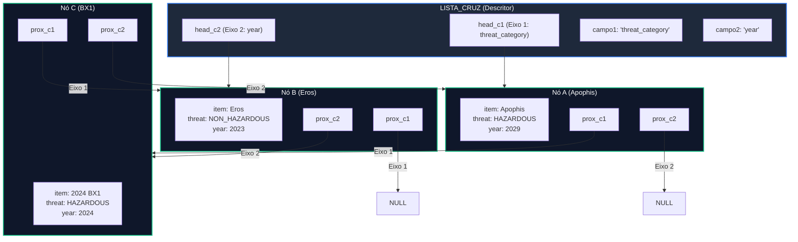
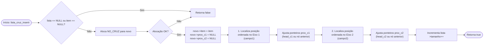

# TAD Lista Cruzada

O módulo `lista_cruz` implementa o Tipo Abstrato de Dados (TAD) **Lista Cruzada (ou Multilista)**. Projetada para atender ao comando `CROSS` da especificação do projeto (ex: `CROSS threat_category year`), essa estrutura permite que o **mesmo registro** participe simultaneamente de duas organizações e ordenações distintas **sem qualquer duplicação do dado** (`ITEM`) ou criação de instâncias redundantes de elementos.

### Visão Geral e Arquitetura

Na Lista Cruzada, cada nó (`NO_CRUZ`) possui um único ponteiro para o dado e dois ponteiros de encadeamento independentes (`prox_c1` e `prox_c2`). Isso cria dois eixos de navegação ortogonais sobre a mesma coleção de dados:

1. **Eixo 1 (`head_c1`):** Encadeia os elementos ordenados sequencialmente com base no **Campo 1** (ex: `threat_category`).
2. **Eixo 2 (`head_c2`):** Encadeia os **mesmos nós** ordenados sequencialmente com base no **Campo 2** (ex: `year`).

#### Vantagem da Abordagem

Ao contrário da criação de duas listas independentes contendo cópias de ponteiros, o nó ortogonal unificado permite liberar a estrutura e o item com segurança em tempo $O(N)$ percorrendo apenas um dos eixos, sem o risco de vazamento de memória ou ponteiros pendentes (_dangling pointers_).

#### Diagrama Arquitetural de Encadeamento Duplo (Mermaid)



### Definição do Tipo de Dados

```c
typedef struct no_cruz_ NO_CRUZ;

struct no_cruz_ {
    ITEM *item;           // Ponteiro para o elemento de dados único 
    NO_CRUZ *prox_c1;     // Ponteiro para o próximo nó no Eixo 1 (Campo 1) 
    NO_CRUZ *prox_c2;     // Ponteiro para o próximo nó no Eixo 2 (Campo 2) 
};

struct lista_cruz_ {
    NO_CRUZ *head_c1;     // Cabeça do encadeamento ordenado pelo Campo 1 
    NO_CRUZ *head_c2;     // Cabeça do encadeamento ordenado pelo Campo 2 
    char campo1[50];      // Nome do campo para ordenação do Eixo 1 
    char campo2[50];      // Nome do campo para ordenação do Eixo 2 
    int tamanho;          // Número total de nós armazenados 
};

```

### Funções

#### `lista_cruz_criar`

Aloca e inicializa a estrutura da Lista Cruzada com ponteiros de cabeça nulos.

```c
LISTA_CRUZ *lista_cruz_criar(void);
```

* **Retorno:** Ponteiro para a instância `LISTA_CRUZ` ou `NULL` em caso de erro de memória.
* **Complexidade:** $$O(1)$$ tempo / $$O(1)$$ espaço.

#### `lista_cruz_configurar`

Define os dois campos que regerão as ordenações paralelas dos dois eixos de encadeamento.

```c
void lista_cruz_configurar(LISTA_CRUZ *lista, const char *campo1, const char *campo2);
```

* **Parâmetros:**
  * `lista`: Ponteiro para a estrutura `LISTA_CRUZ`.
  * `campo1`: Nome da propriedade para o Eixo 1.
  * `campo2`: Nome da propriedade para o Eixo 2.
* **Complexidade:** $$O(1)$$ tempo / $$O(1)$$ espaço.

#### `lista_cruz_inserir`

Aloca um **único nó** `NO_CRUZ` e realiza a inserção ordenada independente em ambos os eixos de encadeamento (`prox_c1` e `prox_c2`).

```c
bool lista_cruz_inserir(void *lista_ptr, ITEM *item);
```

* **Parâmetros:**
  * `lista_ptr`: Ponteiro genérico para a lista (`LISTA_CRUZ *`).
  * `item`: Ponteiro para o registro a ser inserido.
* **Retorno:** `true` se inserido nos dois eixos com sucesso; `false` caso contrário.
* **Complexidade:** $$O(N)$$ tempo / $$O(1)$$ espaço adicional por elemento.

**Fluxograma do Algoritmo de Inserção Dupla (Mermaid)**



#### `lista_cruz_apagar`

Desaloca a memória de todos os nós percorrendo **apenas o encadeamento do Eixo 1**, garantindo que cada nó `NO_CRUZ` e cada `ITEM` sejam liberados exatamente uma vez.

```c
void lista_cruz_apagar(LISTA_CRUZ **lista, bool apagar_itens);
```

* **Parâmetros:**
  * `lista`: Endereço do ponteiro da estrutura. Definitivamente alterado para `NULL`.
  * `apagar_itens`: Se `true`, aciona a função `item_apagar()` para liberar a memória dos itens.
* **Complexidade:** $$O(N)$$ tempo / $$O(1)$$ espaço adicional.

#### `lista_cruz_tamanho` e `lista_cruz_vazia`

```c
int lista_cruz_tamanho(const LISTA_CRUZ *lista);
bool lista_cruz_vazia(const LISTA_CRUZ *lista);
```

* **Complexidade:** $$O(1)$$ tempo / $$O(1)$$ espaço.

#### `lista_cruz_percorrer`

Percorre sequencialmente a lista seguindo o encadeamento principal do Eixo 1, aplicando a função de callback `visitar` a cada item.

```c
void lista_cruz_percorrer(
    const LISTA_CRUZ *lista, 
    void (*visitar)(ITEM *item, void *contexto), 
    void *contexto
);
```

* **Complexidade:** $$O(N)$$ tempo / $$O(1)$$ espaço adicional.

### Análise de Complexidade Assintótica

| **Operação**                                | **Complexidade Temporal** | **Complexidade Espacial** | **Justificativa**                                                              |
| ------------------------------------------- | ------------------------- | ------------------------- | ------------------------------------------------------------------------------ |
| **Criação / Configuração**                  | $$O(1)$$                  | $$O(1)$$                  | Inicialização dos ponteiros de cabeça e nomes dos campos.                      |
| **Inserção Cruzada (`lista_cruz_inserir`)** | $$O(N)$$                  | $$O(1)$$                  | Duas varreduras de busca $O(N)$ para posicionar o nó em `prox_c1` e `prox_c2`. |
| **Percurso (`lista_cruz_percorrer`)**       | $$O(N)$$                  | $$O(1)$$                  | Iteração simples seguindo os ponteiros `prox_c1`.                              |
| **Destruição (`lista_cruz_apagar`)**        | $$O(N)$$                  | $$O(1)$$                  | Varredura única pelo Eixo 1 liberando cada nó e item sem duplicidade.          |

### Exemplo Prático de Uso

O exemplo a seguir simula a aplicação da estrutura para processar o comando `CROSS threat_category year`:

```c
#include <stdio.h>
#include "lista_cruz.h"

void imprimir_item_cruzado(ITEM *item, void *contexto) {
    int *count = (int *) contexto;
    (*count)++;
    printf("[%d] ", *count);
    item_imprimir(item);
}

int main(void) {
    // 1. Criar a Lista Cruzada
    LISTA_CRUZ *lista = lista_cruz_criar();

    // 2. Configurar a relação cruzada entre dois campos (ex: CROSS threat_category year)
    lista_cruz_configurar(lista, "threat_category", "year");

    // 3. Inserir elementos na estrutura cruzada
    ITEM *ast1 = item_criar("99942 Apophis", "HAZARDOUS", "2029");
    ITEM *ast2 = item_criar("433 Eros", "NON_HAZARDOUS", "2023");
    ITEM *ast3 = item_criar("2024 BX1", "HAZARDOUS", "2024");

    lista_cruz_inserir(lista, ast1);
    lista_cruz_inserir(lista, ast2);
    lista_cruz_inserir(lista, ast3);

    // 4. Exibir tamanho e percorrer os registros no eixo principal
    printf("Total de elementos na Lista Cruzada: %d\n", lista_cruz_tamanho(lista));
    
    int contador = 0;
    printf("\nPercurso sequencial no Eixo 1:\n");
    lista_cruz_percorrer(lista, imprimir_item_cruzado, &contador);

    // 5. Destruição segura desalocando o nó único sem duplicar free()
    lista_cruz_apagar(&lista, true);

    return 0;
}

```
