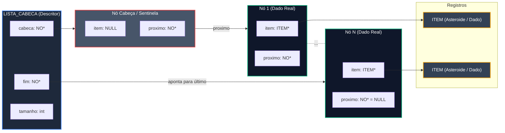
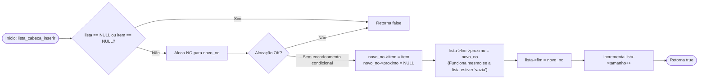

# TAD Lista Encabeçada

O módulo `lista_cabeca` implementa o Tipo Abstrato de Dados (TAD) **Lista Encadeada com Nó Cabeça (ou Sentinela)**. Esta estrutura utiliza um nó especial inicial que não armazena dados de registros do dataset, eliminando exceções e casos especiais de ponteiros nulos nas operações de inserção e percurso.

### Visão Geral e Arquitetura

O diferencial fundamental desta estrutura em relação à lista encadeada simples é a presença do **nó cabeça** (`lista->cabeca`). Ao inicializar a estrutura, esse nó é alocado permanentemente com `item = NULL`.

#### Vantagens do Nó Sentinela

* **Uniformidade de inserção:** Não é necessário checar se `inicio == NULL` ao inserir elementos. O ponteiro `fim` sempre aponta para um nó válido (inicialmente o nó cabeça).
* **Simplificação de algoritmos:** Operações de busca, remoção e inserção não requerem tratamento especial para a primeira posição da lista.

#### Diagrama de Estrutura



### Definição do Tipo de Dados

```c
typedef struct no_ NO;

struct no_ {
    ITEM *item;      // Ponteiro para o elemento armazenado (NULL no nó cabeça) 
    NO *proximo;     // Ponteiro para o próximo nó da lista 
};

struct lista_cabeca_ {
    NO *cabeca;      // Ponteiro para o nó cabeça/sentinela real 
    NO *fim;         // Ponteiro para o último nó inserido 
    int tamanho;     // Número de elementos de dados (exclui o nó cabeça) 
};

```

### Especificação da API

#### `lista_cabeca_criar`

Cria e aloca a estrutura da lista juntamente com o seu nó cabeça inicial.

```c
LISTA_CABECA *lista_cabeca_criar(void);
```

* **Retorno:** Ponteiro para a nova estrutura `LISTA_CABECA` ou `NULL` em caso de falha de alocação de memória.
* **Complexidade:** $$O(1)$$ tempo / $$O(1)$$ espaço.
* **Estado Inicial:** `cabeca->item = NULL`, `cabeca->proximo = NULL`, `fim = cabeca` e `tamanho = 0`.

#### `lista_cabeca_inserir`

Insere um novo registro no final da lista encadeada aproveitando a referência garantida pelo nó cabeça/fim.

```c
bool lista_cabeca_inserir(void *lista_ptr, ITEM *item);
```

* **Parâmetros:**
  * `lista_ptr`: Ponteiro genérico para a lista (`LISTA_CABECA *`).
  * `item`: Ponteiro para o registro a ser inserido.
* **Retorno:** `true` se a inserção for bem-sucedida; `false` se a alocação falhar ou se os parâmetros forem inválidos.
* **Complexidade:** $$O(1)$$ tempo / $$O(1)$$ espaço.

**Fluxo de Inserção Simplificado**



#### `lista_cabeca_apagar`

Libera toda a memória associada à lista, incluindo o nó cabeça, todos os nós de dados e, opcionalmente, os ponteiros de `ITEM`.

```c
void lista_cabeca_apagar(LISTA_CABECA **lista, bool apagar_itens);
```

* **Parâmetros:**
  * `lista`: Endereço do ponteiro para a estrutura `LISTA_CABECA`. É definido para `NULL` ao final.
  * `apagar_itens`: Se `true`, invoca `item_apagar()` nos elementos reais (o nó cabeça é ignorado pois possui `item == NULL`).
* **Complexidade:** $$O(N)$$ tempo / $$O(1)$$ espaço.

#### `lista_cabeca_tamanho`

Retorna o número atual de registros armazenados na lista (excluindo o nó cabeça).

```c
int lista_cabeca_tamanho(const LISTA_CABECA *lista);
```

* **Retorno:** Inteiro indicando a quantidade de registros ou `0` se a lista for nula.
* **Complexidade:** $$O(1)$$ tempo / $$O(1)$$ espaço.

#### `lista_cabeca_vazia`

Verifica se a lista contém apenas o nó cabeça (sem registros de dados).

```c
bool lista_cabeca_vazia(const LISTA_CABECA *lista);
```

* **Retorno:** `true` se estiver vazia ou for `NULL`; `false` caso contrário.
* **Complexidade:** $$O(1)$$ tempo / $$O(1)$$ espaço.

#### `lista_cabeca_percorrer`

Percorre sequencialmente a lista aplicando uma função de callback a cada `ITEM` de dados real, iniciando explicitamente a partir de `cabeca->proximo`.

```c
void lista_cabeca_percorrer(
    const LISTA_CABECA *lista, 
    void (*visitar)(ITEM *item, void *contexto), 
    void *contexto
);
```

* **Parâmetros:**
  * `lista`: Ponteiro para a lista com cabeça.
  * `visitar`: Ponteiro para a função de callback acionada para cada registro.
  * `contexto`: Dados genéricos repassados para o callback.
* **Complexidade:** $$O(N)$$ tempo / $$O(1)$$ espaço adicional.

### Análise de Complexidade Assintótica

<table data-header-hidden><thead><tr><th width="211"></th><th></th><th></th><th></th></tr></thead><tbody><tr><td><strong>Operação</strong></td><td><strong>Complexidade Temporal</strong></td><td><strong>Complexidade Espacial</strong></td><td><strong>Observação</strong></td></tr><tr><td><strong>Criação (<code>lista_cabeca_criar</code>)</strong></td><td><span class="math">O(1)</span><br></td><td><span class="math">O(1)</span></td><td>Aloca descritor e o nó sentinela inicial.</td></tr><tr><td><strong>Inserção (<code>lista_cabeca_inserir</code>)</strong></td><td><span class="math">O(1)</span></td><td><span class="math">O(1)</span></td><td>Sem ramificação condicional para lista vazia.</td></tr><tr><td><strong>Verificação de Vazia (<code>lista_cabeca_vazia</code>)</strong></td><td><span class="math">O(1)</span></td><td><span class="math">O(1)</span></td><td>Consulta direta a <code>tamanho</code>.</td></tr><tr><td><strong>Tamanho (<code>lista_cabeca_tamanho</code>)</strong></td><td><span class="math">O(1)</span></td><td><span class="math">O(1)</span></td><td>Retorno do contador mantido no descritor.</td></tr><tr><td><strong>Percurso (<code>lista_cabeca_percorrer</code>)</strong></td><td><span class="math">O(N)</span></td><td><span class="math">O(1)</span></td><td>Pula o nó cabeça e percorre N nós reais.</td></tr><tr><td><strong>Destruição (<code>lista_cabeca_apagar</code>)</strong></td><td><span class="math">O(N)</span></td><td><span class="math">O(1)</span></td><td>Desaloca o nó cabeça + N nós de dados.</td></tr></tbody></table>

### Exemplo Prático de Uso

Exemplo de utilização da lista com cabeça para carga e processamento de dados do projeto:

```c
#include <stdio.h>
#include "lista_cabeca.h"

void processar_asteroide(ITEM *item, void *contexto) {
    int *total = (int *) contexto;
    (*total)++;
    printf("Registro #%d: ", *total);
    item_imprimir(item);
}

int main(void) {
    // 1. Criar lista com nó cabeça
    LISTA_CABECA *lista = lista_cabeca_criar();

    if (lista_cabeca_vazia(lista)) {
        printf("Lista inicializada vazia (apenas com nó cabeça).\n");
    }

    // 2. Inserção de dados
    ITEM *ast1 = item_criar("C/2023 A3", 15.2);
    ITEM *ast2 = item_criar("433 Eros", 22.8);

    lista_cabeca_inserir(lista, ast1);
    lista_cabeca_inserir(lista, ast2);

    // 3. Consulta de dados
    printf("Quantidade de registros: %d\n", lista_cabeca_tamanho(lista));

    int contador = 0;
    lista_cabeca_percorrer(lista, processar_asteroide, &contador);

    // 4. Liberação de memória (incluindo o nó sentinela)
    lista_cabeca_apagar(&lista, true);

    return 0;
}
```
