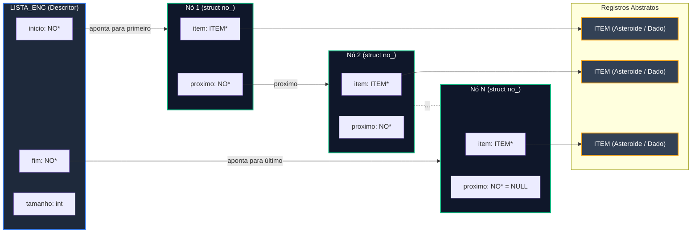

# TAD Lista Encadeada

O módulo `lista_enc` fornece uma implementação do Tipo Abstrato de Dados (TAD) **Lista Simplesmente Encadeada** com alocação dinâmica e opacidade de dados. A estrutura utiliza ponteiros para o primeiro (`inicio`) e último (`fim`) nó, possibilitando operações otimizadas de inserção e percurso.

### Visão Geral e Arquitetura

Nesta estrutura de dados, cada elemento do dataset é armazenado em um nó individual (`NO`), contendo um ponteiro genérico/abstrato para o dado (`ITEM *`) e um ponteiro para o próximo nó da sequência.

#### Diagrama de Estrutura



#### Encapsulamento

A definição das estruturas `struct no_` e `struct lista_enc_` reside exclusivamente no arquivo de implementação (`lista_enc.c`). O cabeçalho (`lista_enc.h`) expõe apenas ponteiros opacos (`LISTA_ENC *`), garantindo:

* **Modularização:** O código cliente não depende da representação interna.
* **Segurança de Memória:** Impedimento de acessos e modificações diretas aos campos internos.

### Definição do Tipo de Dados

```c
typedef struct no_ NO;

struct no_ {
    ITEM *item;      /* Ponteiro para o dado genérico */
    NO *proximo;     /* Ponteiro para o próximo nó da lista */
};

struct lista_enc_ {
    NO *inicio;      /* Ponteiro para o primeiro nó */
    NO *fim;         /* Ponteiro para o último nó */
    int tamanho;     /* Número de elementos contidos na lista */
};

```

### Funções

#### `lista_enc_criar`

Cria e inicializa uma nova lista encadeada vazia.

```c
LISTA_ENC *lista_enc_criar(void);

```

* **Retorno:** Ponteiro para a instância de `LISTA_ENC` criada ou `NULL` em caso de falha de alocação de memória.
* **Complexidade:** $O(1)$ tempo / $O(1)$ espaço.

#### `lista_enc_inserir`

Insere um elemento no final da lista encadeada. O tipo do ponteiro de entrada é `void *` para permitir interoperabilidade genérica com contêineres e seletores do projeto.

```c
bool lista_enc_inserir(void *lista_ptr, ITEM *item);

```

* **Parâmetros:**
  * `lista_ptr`: Ponteiro para a estrutura `LISTA_ENC` (convertido internamente).
  * `item`: Ponteiro para o `ITEM` a ser inserido.
* **Retorno:** `true` se inserido com sucesso; `false` se a lista/item for nulo ou falhar a alocação do nó.
* **Complexidade:** $O(1)$ tempo / $O(1)$ espaço.
* **Comportamento:** Atualiza o ponteiro `fim` para o novo nó em tempo constante, sem necessidade de percorrer a lista.

#### `lista_enc_apagar`

Desaloca toda a memória alocada pela lista e pelos seus nós. Opcionalmente, libera também a memória dos elementos internos (`ITEM`).

```c
void lista_enc_apagar(LISTA_ENC **lista, bool apagar_itens);

```

* **Parâmetros:**
  * `lista`: Endereço do ponteiro para a lista (`LISTA_ENC **`). É definido como `NULL` ao final do processo.
  * `apagar_itens`: Se `true`, chama a função `item_apagar()` para cada nó. Se `false`, desaloca apenas a estrutura da lista e os nós.
* **Complexidade:** $O(N)$ tempo / $O(1)$ espaço adicional, onde $N$ é a quantidade de elementos armazenados.

#### `lista_enc_tamanho`

Retorna a quantidade total de elementos atualmente armazenados na lista.

```c
int lista_enc_tamanho(const LISTA_ENC *lista);

```

* **Parâmetros:**
  * `lista`: Ponteiro de leitura para a lista.
* **Retorno:** O tamanho inteiro atual da lista (ou `0` se a lista for nula).
* **Complexidade:** $O(1)$ tempo / $O(1)$ espaço.

#### `lista_enc_percorrer`

Percorre a lista do primeiro ao último nó, aplicando uma função de callback a cada `ITEM`.

```c
void lista_enc_percorrer(
    const LISTA_ENC *lista, 
    void (*visitar)(ITEM *item, void *contexto), 
    void *contexto
);

```

* **Parâmetros:**
  * `lista`: Ponteiro para a lista encadeada.
  * `visitar`: Função de callback acionada para cada nó.
  * `contexto`: Ponteiro opcional com dados auxiliares repassados ao callback (ex: contadores, filtros, ponteiro de saída).
* **Complexidade:** $O(N)$ tempo / $O(1)$ espaço adicional.

### Análise de Complexidade Assintótica

A tabela a seguir apresenta os custos assintóticos observados para as operações do TAD:

<table data-header-hidden><thead><tr><th width="219"></th><th></th><th></th><th width="201"></th></tr></thead><tbody><tr><td><strong>Operação</strong></td><td><strong>Complexidade Temporal</strong></td><td><strong>Complexidade Espacial</strong></td><td><strong>Justificativa</strong></td></tr><tr><td><strong>Criação (<code>lista_enc_criar</code>)</strong></td><td><span class="math">O(1)</span></td><td><span class="math">O(1)</span></td><td>Alocação da struct e ajuste inicial de ponteiros.</td></tr><tr><td><strong>Inserção (<code>lista_enc_inserir</code>)</strong></td><td><span class="math">O(1)</span></td><td><span class="math">O(1)</span></td><td>Inserção direta utilizando o ponteiro <code>fim</code>.</td></tr><tr><td><strong>Tamanho (<code>lista_enc_tamanho</code>)</strong></td><td><span class="math">O(1)</span><br></td><td><span class="math">O(1)</span></td><td>Leitura direta do atributo <code>tamanho</code>.</td></tr><tr><td><strong>Percurso (<code>lista_enc_percorrer</code>)</strong></td><td><span class="math">O(N)</span></td><td><span class="math">O(N)</span></td><td>Iteração encadeada sobre N nós.</td></tr><tr><td><strong>Remoção total (<code>lista_enc_apagar</code>)</strong></td><td><span class="math">O(N)</span></td><td><span class="math">O(1)</span></td><td>Liberação sequencial de cada nó da memória.</td></tr></tbody></table>

### Exemplo Prático de Uso

O exemplo abaixo demonstra a integração do TAD na carga e leitura de dados:

```c
#include <stdio.h>
#include "lista_enc.h"

// Callback para exibir informações do item
void imprimir_item(ITEM *item, void *contexto) {
    int *contador = (int *) contexto;
    (*contador)++;
    printf("[%d] ", *contador);
    item_imprimir(item);
}

int main(void) {
    // 1. Criar a lista
    LISTA_ENC *base_dados = lista_enc_criar();

    // 2. Inserir elementos na lista
    ITEM *ast1 = item_criar("2024 BX1", 12.5);
    ITEM *ast2 = item_criar("99942 Apophis", 31.0);

    lista_enc_inserir(base_dados, ast1);
    lista_enc_inserir(base_dados, ast2);

    // 3. Imprimir dados e tamanho
    printf("Total de registros: %d\n", lista_enc_tamanho(base_dados));
    
    int contador = 0;
    lista_enc_percorrer(base_dados, imprimir_item, &contador);

    // 4. Destruir a lista liberando a memória dos itens
    lista_enc_apagar(&base_dados, true);

    return 0;
}
```
