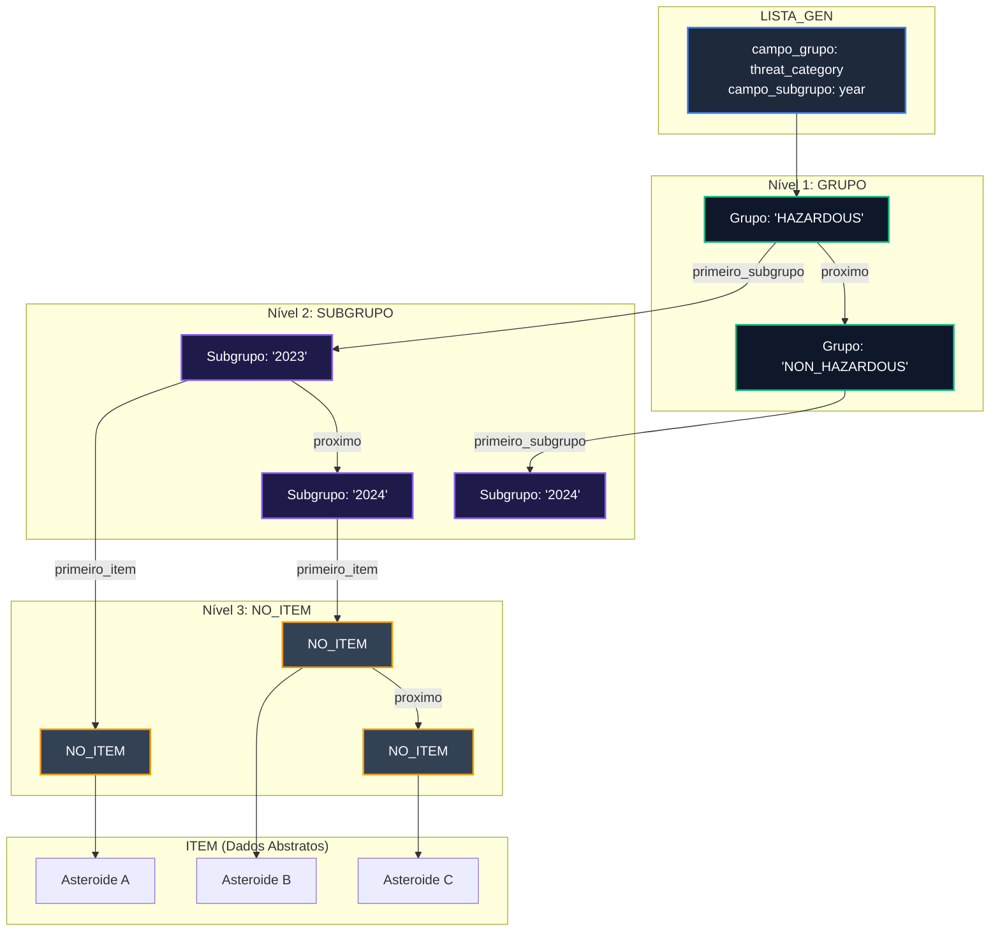

# TAD Lista Generalizada

O módulo `lista_gen` implementa o Tipo Abstrato de Dados (TAD) **Lista Generalizada Hierárquica**. Projetada especificamente para suportar o comando `GROUP` do projeto (ex: `GROUP threat_category|year`), esta estrutura organiza os elementos em uma hierarquia de dois níveis de agrupamento (**Grupo** e **Subgrupo**), contendo listas encadeadas de registros na camada final.

### Visão Geral e Arquitetura

A Lista Generalizada diverge de listas lineares convencionais por adotar uma **árvore/floresta encadeada de profundidade fixa**:

1. **Nível 1 (Descritor):** Guarda as chaves dos campos selecionados para agrupamento (`campo_grupo` e `campo_subgrupo`) e o ponteiro para a cabeça da lista de grupos.
2. **Nível 2 (Grupos):** Lista encadeada de nós `GRUPO`, cada um representando um valor único do primeiro campo (ex: `"HAZARDOUS"`).
3. **Nível 3 (Subgrupos):** Lista encadeada de nós `SUBGRUPO`, associada a um grupo, representando valores do segundo campo (ex: `"2024"`).
4. **Nível 4 (Nós de Itens):** Lista encadeada simples de `NO_ITEM`, contendo ponteiros diretos para os registros `ITEM`.

#### Diagrama Arquitetural em Tree/Graph (Mermaid)



### Definição das Estruturas Internas

A implementação utiliza três tipos de nós encadeados internamente:

```c
typedef struct no_item_ {
    ITEM *item;                    // Ponteiro para o elemento de dados 
    struct no_item_ *proximo;     // Próximo nó de item no mesmo subgrupo 
} NO_ITEM;

typedef struct subgrupo_ {
    char chave[50];                // Valor do campo de subgrupo (ex: "2024") 
    NO_ITEM *primeiro_item;        // Início da lista de itens do subgrupo 
    struct subgrupo_ *proximo;     // Próximo subgrupo do mesmo grupo 
} SUBGRUPO;

typedef struct grupo_ {
    char chave[50];                // Valor do campo principal (ex: "HAZARDOUS") 
    SUBGRUPO *primeiro_subgrupo;   // Início da lista de subgrupos 
    struct grupo_ *proximo;        // Próximo grupo principal 
} GRUPO;

struct lista_gen_ {
    GRUPO *primeiro_grupo;         // Cabeça da lista de grupos 
    char campo_grupo[50];          // Nome do campo para Nível 1 
    char campo_subgrupo[50];       // Nome do campo para Nível 2 
    int tamanho;                   // Total de itens armazenados na estrutura 
};

```

### Funções

#### `lista_gen_criar`

Cria e inicializa uma lista generalizada vazia.

```c
LISTA_GEN *lista_gen_criar(void);
```

* **Retorno:** Ponteiro para a instância `LISTA_GEN` ou `NULL` em caso de falha de alocação.
* **Complexidade:** $$O(1)$$ tempo / $$O(1)$$ espaço.

#### `lista_gen_configurar`

Define os dois campos que guiarão a criação automática de grupos e subgrupos durante as inserções.

```c
void lista_gen_configurar(LISTA_GEN *lista, const char *campo_grupo, const char *campo_subgrupo);
```

* **Parâmetros:**
  * `lista`: Ponteiro para a estrutura `LISTA_GEN`.
  * `campo_grupo`: Nome do campo primário (ex: `"threat_category"`).
  * `campo_subgrupo`: Nome do campo secundário (ex: `"year"`).
* **Complexidade:** $$O(1)$$ tempo / $$O(1)$$ espaço.

#### `lista_gen_inserir`

Insere um registro na estrutura. Extrai os valores das chaves de grupo e subgrupo do `ITEM`. Se os respectivos nó `GRUPO` ou `SUBGRUPO` não existirem, eles são criados dinamicamente na hierarquia.

```c
bool lista_gen_inserir(void *lista_ptr, ITEM *item);
```

* **Parâmetros:**
  * `lista_ptr`: Ponteiro genérico para `LISTA_GEN`.
  * `item`: Registro a ser classificado e inserido.
* **Retorno:** `true` se o item for alocado com sucesso; `false` em falhas de memória ou parâmetros nulos.
* **Complexidade:** $$O(G + S + i_k)$$ tempo, onde G é o número de grupos, S é o número de subgrupos no grupo correspondente e i<sub>k</sub> é a quantidade de itens no subgrupo.

**Fluxo de Inserção Hierárquica (Mermaid)**

```mermaid
flowchart LR
    A([Início: lista_gen_inserir]) --> B{Validação de ponteiros}
    B -- Inválido --> C[Retorna false]
    B -- Válido --> D[Extrai chave_grupo e chave_subgrupo do ITEM]
    D --> E[Busca Grupo com chave_grupo]
    E --> F{Grupo existe?}
    F -- Não --> G[Aloca novo GRUPO e encadeia na lista de grupos]
    F -- Sim --> H[Seleciona GRUPO existente]
    G --> H
    H --> I[Busca Subgrupo com chave_subgrupo no GRUPO]
    I --> J{Subgrupo existe?}
    J -- Não --> K[Aloca novo SUBGRUPO e encadeia no GRUPO]
    J -- Sim --> L[Seleciona SUBGRUPO existente]
    K --> L
    L --> M[Aloca novo NO_ITEM e insere ao final do SUBGRUPO]
    M --> N[Incrementa lista->tamanho++]
    N --> O([Retorna true])

```



#### `lista_gen_percorrer`

Percorre todos os registros armazenados na lista em ordem hierárquica (Grupo a Grupo, Subgrupo a Subgrupo, Item a Item) executando a função de callback `visitar`.

```c
void lista_gen_percorrer(
    const LISTA_GEN *lista, 
    void (*visitar)(ITEM *item, void *contexto), 
    void *contexto
);
```

* **Complexidade:** $$O(N)$$ tempo / $$O(1)$$ espaço adicional, onde $N$ é o total de itens.

#### `lista_gen_apagar`

Desaloca iterativamente todos os três níveis de nós encadeados (`GRUPO`, `SUBGRUPO`, `NO_ITEM`), além da própria estrutura descritora. Opcionalmente desaloca a memória dos objetos `ITEM`.

```c
void lista_gen_apagar(LISTA_GEN **lista, bool apagar_itens);
```

* **Complexidade:** $$O(N + G + S_{total})$$ tempo / $$O(1)$$ espaço adicional.

#### `lista_gen_tamanho` e `lista_gen_vazia`

```c
int lista_gen_tamanho(const LISTA_GEN *lista);
bool lista_gen_vazia(const LISTA_GEN *lista);
```

* **Complexidade:** $$O(1)$$ tempo / $$O(1)$$ espaço.

### Análise de Complexidade Assintótica

<table data-header-hidden><thead><tr><th width="211"></th><th></th><th></th><th></th></tr></thead><tbody><tr><td><strong>Operação</strong></td><td><strong>Complexidade Temporal (Pior Caso)</strong></td><td><strong>Complexidade Espacial</strong></td><td><strong>Observação</strong></td></tr><tr><td><strong>Criação / Configuração</strong></td><td><span class="math">O(1)</span></td><td><span class="math">O(1)</span></td><td>Inicialização simples do descritor.</td></tr><tr><td><strong>Inserção (<code>lista_gen_inserir</code>)</strong></td><td><span class="math">O(N + G + S_{total})</span></td><td><span class="math">O(1)</span> aux.</td><td>Busca sequencial nos níveis de Grupo, Subgrupo e inserção na cauda do nó de item. Pode chegar a $O(N)$ no pior caso.</td></tr><tr><td><strong>Percurso (<code>lista_gen_percorrer</code>)</strong></td><td><span class="math">O(N)</span></td><td><span class="math">O(1)</span> aux.</td><td>Três <code>loops</code> aninhados que visitam cada nó de item exatamente uma vez.</td></tr><tr><td><strong>Destruição (<code>lista_gen_apagar</code>)</strong></td><td><span class="math">O(N + G + S_{total})</span></td><td><span class="math">O(1)</span> aux.</td><td>Varredura e liberação completa de nós da árvore/floresta.</td></tr></tbody></table>

### Exemplo Prático de Uso

O código a seguir demonstra o uso do TAD para satisfazer o comando `GROUP threat_category|year` em dados de asteroides:

```c
#include <stdio.h>
#include "lista_gen.h"

void exibir_registro(ITEM *item, void *contexto) {
    int *count = (int *) contexto;
    (*count)++;
    printf("[%d] ", *count);
    item_imprimir(item);
}

int main(void) {
    // 1. Criar a Lista Generalizada
    LISTA_GEN *lista_agrupada = lista_gen_criar();

    // 2. Configurar os campos para os níveis de Grupo e Subgrupo (ex: GROUP threat_category|year)
    lista_gen_configurar(lista_agrupada, "threat_category", "year");

    // 3. Inserir elementos (a estrutura organizará dinamicamente)
    ITEM *ast1 = item_criar("2024 BX1", "HAZARDOUS", "2024");
    ITEM *ast2 = item_criar("433 Eros", "NON_HAZARDOUS", "2023");
    ITEM *ast3 = item_criar("99942 Apophis", "HAZARDOUS", "2024");

    lista_gen_inserir(lista_agrupada, ast1);
    lista_gen_inserir(lista_agrupada, ast2);
    lista_gen_inserir(lista_agrupada, ast3);

    // 4. Exibir o total de itens e percorrer em ordem de agrupamento
    printf("Total de itens agrupados: %d\n", lista_gen_tamanho(lista_agrupada));

    int contador = 0;
    lista_gen_percorrer(lista_agrupada, exibir_registro, &contador);

    // 5. Destruição completa da estrutura hierárquica
    lista_gen_apagar(&lista_agrupada, true);

    return 0;
}
```
