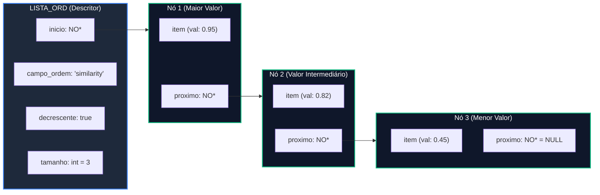
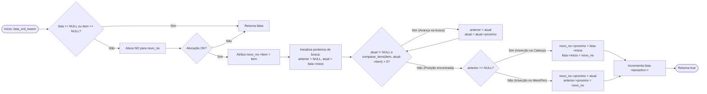

# TAD Lista Ordenada

O módulo `lista_ord` implementa o Tipo Abstrato de Dados (TAD) **Lista Encadeada Ordenada**. Diferente de abordagens que ordenam o conjunto de dados após a leitura completa, este TAD garante que **a ordem é mantida continuamente durante o processo de inserção** (Inserção Ordenada), atendendo rigorosamente aos requisitos do projeto.

### Visão Geral e Arquitetura

A ordenação da lista é guiada por metadados configurados dinamicamente no descritor da lista (`campo_ordem` e `decrescente`). A comparação entre elementos e o roteamento entre valores numéricos ou textuais é tratada internamente pela função auxiliar `comparar_itens`.

#### Requisito Obrigatório

Conforme especificado no projeto, não é permitido inserir todos os registros e ordená-los ao final. Cada chamada a `lista_ord_inserir` localiza a posição correta do item através de um percurso $$O(N)$$ e o insere no local adequado.

#### Diagrama de Estrutura



### Definição do Tipo de Dados

```c
typedef struct no_ NO;

struct no_ {
    ITEM *item;              // Ponteiro para o elemento de dados 
    NO *proximo;             // Ponteiro para o próximo nó da lista 
};

struct lista_ord_ {
    NO *inicio;              // Ponteiro para o primeiro nó da lista 
    int tamanho;             // Número de elementos na lista 
    char campo_ordem[50];    // Nome do campo do ITEM usado como chave de ordenação 
    bool decrescente;        // Flag: false = Crescente (ASC), true = Decrescente (DESC) 
};

```

### Lógica Interna de Comparação

A ordenação é agnóstica em relação ao tipo do campo. A função estática `comparar_itens` tenta primeiro extrair o valor como **numérico** (`item_get_numero`). Caso o campo não seja numérico (retornando `-1.0`), ela tenta extraí-lo como **texto/string** (`item_get_texto`) para realizar comparação alfabética via `strcmp`.

```c
static int comparar_itens(const ITEM *a, const ITEM *b, const char *campo, bool decrescente);
```

### Especificação da API

#### `lista_ord_criar`

Aloca e inicializa uma lista ordenada vazia com os parâmetros de ordenação padrão (campo vazio, ordem crescente).

```c
LISTA_ORD *lista_ord_criar(void);
```

* **Retorno:** Ponteiro para a instância de `LISTA_ORD` criada ou `NULL` em caso de falha de memória.
* **Complexidade:** $$O(1)$$ tempo / $$O(1)$$ espaço.

#### `lista_ord_configurar_ordem`

Define o campo do `ITEM` que será utilizado como chave para manter a ordenação e a direção da ordenação (crescente ou decrescente).

```c
void lista_ord_configurar_ordem(LISTA_ORD *lista, const char *campo, bool decrescente);
```

* **Parâmetros:**
  * `lista`: Ponteiro para o TAD `LISTA_ORD`.
  * `campo`: Nome da coluna/chave do item (ex: `"similarity"`, `"distance_au"`, `"year"`).
  * `decrescente`: `true` para ordem decrescente (DESC) ou `false` para ordem crescente (ASC).
* **Complexidade:** $$O(1)$$ tempo / $$O(1)$$ espaço.

#### `lista_ord_inserir`

Insere o novo item na **posição exata** de forma a manter a ordenação preestabelecida.

```c
bool lista_ord_inserir(void *lista_ptr, ITEM *item);
```

* **Parâmetros:**
  * `lista_ptr`: Ponteiro genérico para a lista (`LISTA_ORD *`).
  * `item`: Ponteiro para o registro a ser inserido.
* **Retorno:** `true` em caso de sucesso; `false` se a alocação falhar ou entradas forem nulas.
* **Complexidade:** $$O(N)$$ tempo / $$O(1)$$ espaço adicional.

**Fluxograma da Inserção Ordenada**



#### `lista_ord_apagar`

Desaloca sequencialmente a memória de todos os nós da lista e, opcionalmente, de seus respectivos itens.

```c
void lista_ord_apagar(LISTA_ORD **lista, bool apagar_itens);
```

* **Parâmetros:**
  * `lista`: Endereço do ponteiro da lista. É configurado como `NULL` ao término.
  * `apagar_itens`: Se `true`, invoca `item_apagar()` para liberar a memória de cada `ITEM`.
* **Complexidade:** $$O(N)$$ tempo / $$O(1)$$ espaço.

#### `lista_ord_tamanho`

Retorna a quantidade de itens atualmente armazenados.

```c
int lista_ord_tamanho(const LISTA_ORD *lista);
```

* **Complexidade:** $$O(1)$$ tempo / $$O(1)$$ espaço.

#### `lista_ord_vazia`

Informa se a lista está vazia.

```c
bool lista_ord_vazia(const LISTA_ORD *lista);
```

* **Complexidade:** $$O(1)$$ tempo / $$O(1)$$ espaço.

#### `lista_ord_percorrer`

Itera sobre a lista na **ordem estipulada**, invocando a função de callback `visitar` para cada elemento armazenado.

```c
void lista_ord_percorrer(
    const LISTA_ORD *lista, 
    void (*visitar)(ITEM *item, void *contexto), 
    void *contexto
);
```

* **Complexidade:** $O(N)$ tempo / $O(1)$ espaço.

### Análise de Complexidade Assintótica

Para a inserção de $N$ elementos em uma lista inicialmente vazia, a complexidade de tempo total acumulada é $O(N^2)$, devido ao custo $O(N)$ de cada inserção individual.

| **Operação**                                    | **Complexidade Temporal** | **Complexidade Espacial** | **Justificativa**                                |
| ----------------------------------------------- | ------------------------- | ------------------------- | ------------------------------------------------ |
| **Criação (`lista_ord_criar`)**                 | $$O(1)$$                  | $$O(1)$$                  | Alocação da struct e valores padrão.             |
| **Configuração (`lista_ord_configurar_ordem`)** | $$O(1)$$                  | $$O(1)$$                  | Copia da string do campo e atribuição da flag.   |
| **Inserção Ordenada (`lista_ord_inserir`)**     | $$O(N)$$                  | $$O(1)$$                  | Percurso linear até encontrar a posição correta. |
| **Consulta de Tamanho (`lista_ord_tamanho`)**   | $$O(1)$$                  | $$O(1)$$                  | Leitura direta do atributo `tamanho`.            |
| **Percurso (`lista_ord_percorrer`)**            | $$O(N)$$                  | $$O(1)$$                  | Iteração sequencial ordenada sobre N nós.        |
| **Destruição (`lista_ord_apagar`)**             | $$O(N)$$                  | $$O(1)$$                  | Varredura e desalocação sequencial.              |

### Exemplo Prático de Uso

O exemplo a seguir simula a recepção do comando `ORDER similarity|DESC` do arquivo de consulta do projeto:

```c
#include <stdio.h>
#include "lista_ord.h"

void imprimir_asteroide(ITEM *item, void *contexto) {
    int *pos = (int *) contexto;
    (*pos)++;
    printf("#%d ", *pos);
    item_imprimir(item);
}

int main(void) {
    // 1. Criar a lista ordenada
    LISTA_ORD *resultados = lista_ord_criar();

    // 2. Configurar a ordenação pelo campo 'similarity' em ordem decrescente (DESC)
    lista_ord_configurar_ordem(resultados, "similarity", true);

    // 3. Inserir elementos (a ordem de inserção é arbitrária, mas a lista mantém ordenada)
    ITEM *ast1 = item_criar("2024 BX1", 0.65);
    ITEM *ast2 = item_criar("99942 Apophis", 0.98);
    ITEM *ast3 = item_criar("433 Eros", 0.81);

    lista_ord_inserir(resultados, ast1); // Posição atual: [0.65]
    lista_ord_inserir(resultados, ast2); // Posição atual: [0.98, 0.65]
    lista_ord_inserir(resultados, ast3); // Posição atual: [0.98, 0.81, 0.65]

    // 4. Imprimir os resultados (saída ordenada: Apophis -> Eros -> 2024 BX1)
    printf("Resultados ordenados por similaridade (DESC):\n");
    int posicao = 0;
    lista_ord_percorrer(resultados, imprimir_asteroide, &posicao);

    // 5. Desalocar memória
    lista_ord_apagar(&resultados, true);

    return 0;
}
```
