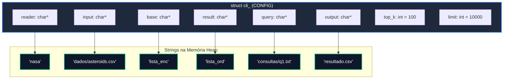
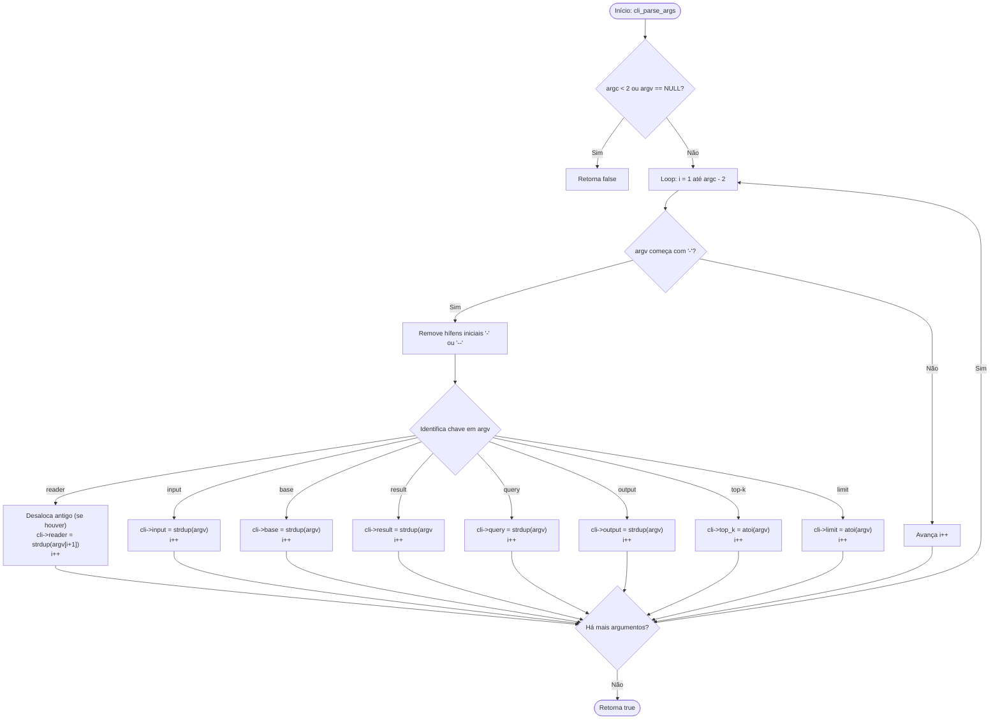

# TAD CLI

## TAD Interface de Linha de Comando (`cli`)

O módulo `cli` implementa o Tipo Abstrato de Dados (TAD) **CONFIG / CLI**, responsável por capturar, validar, armazenar e disponibilizar os parâmetros de execução fornecidos ao executável do programa (`trabalho`) através da linha de comando.

Este TAD centraliza as opções de configuração do projeto, como a escolha do leitor, arquivo de entrada, estruturas de dados base e de resultado, arquivo de consulta, arquivo de saída e os limites de processamento (`top-k` e `limit`).

### Visão Geral e Arquitetura

O TAD `CONFIG` atua como a primeira camada de execução do programa. Ele parseia `argc` e `argv`, permitindo flexibilidade na sintaxe dos argumentos — aceitando tanto hífens simples (`-reader`, `-input`) quanto hífens duplos (`--reader`, `--input`).

#### Parâmetros Suportados

| **Argumento CLI**      | **Função Interna** | **Descrição**                                                        | **Valor Padrão** |
| ---------------------- | ------------------ | -------------------------------------------------------------------- | ---------------- |
| `-reader` / `--reader` | `reader`           | Nome do leitor do dataset (`nasa`, `detran`, etc.)                   | `NULL`           |
| `-input` / `--input`   | `input`            | Caminho do arquivo CSV de entrada                                    | `NULL`           |
| `-base` / `--base`     | `base`             | Estrutura de dados para carregar a base completa                     | `NULL`           |
| `-result` / `--result` | `result`           | Estrutura de dados para os resultados da busca                       | `NULL`           |
| `-query` / `--query`   | `query`            | Caminho do arquivo de regras de consulta texto                       | `NULL`           |
| `-output` / `--output` | `output`           | Caminho do arquivo CSV de saída                                      | `NULL`           |
| `-top-k` / `--top-k`   | `top_k`            | Máximo de registros exportados ($0 = \text{todos}$)                  | <p>$0$<br></p>   |
| `-limit` / `--limit`   | `limit`            | Máximo de registros carregados da entrada ($0 = \text{toda a base}$) | <p>$0$<br></p>   |

### Definição da Estrutura Interna

A estrutura `struct cli_` (renomeada via `typedef` para `CONFIG`) armazena strings alocadas dinamicamente para os caminhos e tipos, e inteiros para as opções numéricas.

```c
struct cli_ {
    char *reader;   /* Nome do leitor selecionado (ex: "nasa") */
    char *input;    /* Caminho do arquivo de entrada (ex: "dados/asteroids.csv") */
    char *base;     /* Nome do TAD base (ex: "lista_enc") */
    char *result;   /* Nome do TAD resultado (ex: "lista_ord") */
    char *query;    /* Caminho da consulta (ex: "consultas/q1.txt") */
    char *output;   /* Caminho do arquivo de saída (ex: "resultado.csv") */
    int top_k;      /* Limite de registros salvos na saída (0 = sem limite) */
    int limit;      /* Limite de registros lidos da entrada (0 = sem limite) */
};
```

#### Diagrama Estrutural do TAD CONFIG



#### Fluxograma do Parsing de Argumentos (`cli_parse_args`)



### Especificação da API

#### `cli_criar`

Aloca e inicializa a estrutura de configuração `CONFIG` zerada via `calloc`.

```c
CONFIG *cli_criar(void);
```

* **Retorno:** Ponteiro para a nova estrutura `CONFIG` criada ou `NULL` em caso de falha de alocação.
* **Complexidade:** O(1) tempo / O(1) espaço.

#### `cli_apagar`

Desaloca iterativamente todas as strings alocadas no `heap` (`reader`, `input`, `base`, `result`, `query`, `output`) e libera a memória da estrutura `CONFIG`.

```c
bool cli_apagar(CONFIG **cli);
```

* **Parâmetros:**
  * `cli`: Endereço do ponteiro para a estrutura `CONFIG`. É alterado para `NULL` ao final.
* **Retorno:** `true` se a desalocação ocorrer com sucesso; `false` se o ponteiro for nulo.
* **Complexidade:** O(1) tempo / O(1) espaço.

#### `cli_parse_args`

Processa o vetor de argumentos `argv` passado na execução do programa e preenche os campos do TAD `CONFIG`.

```c
bool cli_parse_args(CONFIG *cli, int argc, char* argv[]);
```

* **Parâmetros:**
  * `cli`: Ponteiro para o TAD `CONFIG`.
  * `argc`: Quantidade total de argumentos da linha de comando.
  * `argv`: Vetor de strings contendo os argumentos.
* **Retorno:** `true` em caso de sucesso no parsing; `false` se os parâmetros forem inválidos ou insuficientes.
* **Complexidade:** $$O(A \cdot S)$$ tempo, onde $$A = \text{argc}$$ e S é a extensão média da string do argumento.

#### Getters de Configuração

Permitem acesso seguro e em tempo constante $O(1)$ aos parâmetros de configuração:

```c
const char* cli_get_reader(const CONFIG *cli);
const char* cli_get_input(const CONFIG *cli);
const char* cli_get_base(const CONFIG *cli);
const char* cli_get_result(const CONFIG *cli);
const char* cli_get_query(const CONFIG *cli);
const char* cli_get_output(const CONFIG *cli);
int cli_get_top_k(const CONFIG *cli);
int cli_get_limit(const CONFIG *cli);

```

* **Complexidade:** $O(1)$ tempo / $O(1)$ espaço.

#### `cli_imprimir_config`

Função utilitária de depuração para exibir no console a configuração carregada.

```c
void cli_imprimir_config(const CONFIG *cli);
```

* **Complexidade:** $O(1)$ tempo / $O(1)$ espaço.

### Análise de Complexidade Assintótica

Considerando $A$ como o número de argumentos em `argv` ($A = \text{argc}$):

| **Operação**              | **Complexidade Temporal** | **Complexidade Espacial** | **Justificativa**                                                  |
| ------------------------- | ------------------------- | ------------------------- | ------------------------------------------------------------------ |
| **`cli_criar`**           | O(1)                      | O(1)                      | Alocação direta da estrutura.                                      |
| **`cli_parse_args`**      | O(A)                      | O(S\_{total})             | Varredura única de `argv` com alocação das strings dos parâmetros. |
| **`cli_get_*` (Getters)** | O(1)                      | O(1)                      | Acesso direto aos campos da estrutura.                             |
| **`cli_apagar`**          | O(1)                      | O(1)                      | Liberação dos 6 ponteiros de string e da struct.                   |

### Exemplo Prático de Uso

O exemplo a seguir demonstra o ciclo típico de inicialização e leitura de opções no `main.c`:

```c
#include <stdio.h>
#include "cli.h"

int main(int argc, char *argv[]) {
    // 1. Criar a estrutura de configuração CLI
    CONFIG *config = cli_criar();
    if (config == NULL) {
        fprintf(stderr, "Erro ao alocar estrutura de configuração.\n");
        return 1;
    }

    // 2. Realizar o parse dos argumentos fornecidos
    if (!cli_parse_args(config, argc, argv)) {
        fprintf(stderr, "Uso incorreto dos argumentos da CLI.\n");
        cli_apagar(&config);
        return 1;
    }

    // 3. Exibir a configuração para verificação
    cli_imprimir_config(config);

    // 4. Recuperar valores dos parâmetros para uso no fluxo principal
    const char *reader = cli_get_reader(config);
    const char *base = cli_get_base(config);
    int limit = cli_get_limit(config);

    printf("Iniciando leitor '%s' na estrutura '%base' com limite %d...\n", 
           reader, base, limit);

    // 5. Desalocar a memória da CLI ao encerrar
    cli_apagar(&config);

    return 0;
}

```
