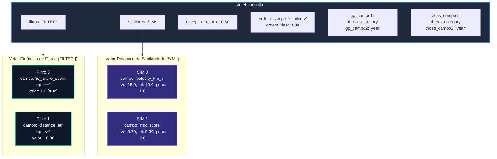
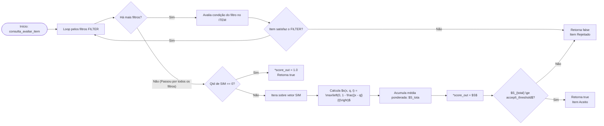

# TAD CONSULTA

## TAD Consulta (`consulta`)

O módulo `consulta` implementa o Tipo Abstrato de Dados (TAD) **Consulta**, responsável por carregar e processar as regras de filtragem, similaridade, ordenação e agrupamento fornecidas via arquivo de consulta texto (`--query`).

Este TAD atua como o motor de regras da aplicação, avaliando se cada `ITEM` lido da estrutura base é aceito e qual seu grau de similaridade ($$S_{total}$$).

### Visão Geral e Arquitetura

O TAD `CONSULTA` compõe as diretrizes lidas do arquivo de instrução de busca. O arquivo de consulta suporta 6 comandos fundamentais:

1. **`FILTER`**: Condição booleana obrigatória (ex: `FILTER distance_au|<=10.08`). Suporta operadores de comparação numéricos (`==`, `!=`, `<`, `<=`, `>`, `>=`) e textuais (`==`, `!=`).
2. **`SIM`**: Critério numérico de similaridade no formato `<campo> <alvo> <tolerância> <peso>` (ex: `SIM velocity_km_s|15.0 10.0 1.0`).
3. **`ACCEPT`**: Limiar mínimo $$L \in [0, 1]$$ para aceitação da similaridade ponderada total (ex: `ACCEPT 0.60`).
4. **`ORDER`**: Chave e direção para ordenação dos resultados (`ORDER similarity|DESC`).
5. **`GROUP`**: Campos para estruturação hierárquica em 2 níveis na Lista Generalizada (`GROUP threat_category|year`).
6. **`CROSS`**: Campos para estruturação com duplo encadeamento na Lista Cruzada (`CROSS threat_category year`).

### Modelo Matemático de Similaridade

Para um valor de atributo x, valor alvo q e tolerância t > 0, a similaridade local s(x, q, t) é calculada por:

$$
s(x, q, t) = \max\left(0, 1 - \frac{\vert{}x - q\vert{}}{t}\right)
$$

Com $k$ critérios de similaridade definidos (`SIM`), com pesos $$w_i > 0$$, a similaridade ponderada total $$S_{total}$$ é dada pela média ponderada:

$$
S_{total} = \frac{\sum_{i=1}^{k} s(x_i, q_i, t_i) \cdot w_i}{\sum_{i=1}^{k} w_i}
$$

Se não houver nenhum comando `SIM` configurado na consulta, qualquer registro que atenda a todos os `FILTER` recebe $$S_{total} = 1.0$$.

### Definição das Estruturas Internas

```c
typedef struct filter_ {
    char campo[50];       /* Nome do campo a ser avaliado */
    char operador[5];     /* Operador: "==", "!=", "<=", ">=", "<", ">" */
    char valor_str[50];   /* Valor em formato texto */
    double valor_num;     /* Valor em formato numérico (se aplicável) */
    bool numerico;        /* Indica se o filtro é numérico ou texto */
} FILTER;

typedef struct sim_ {
    char campo[50];       /* Nome do campo numérico */
    double alvo;          /* Valor de referência (q) */
    double tolerancia;    /* Tolerância máxima (t) */
    double peso;          /* Peso da métrica na média ponderada (w) */
} SIM;

struct consulta_ {
    FILTER *filtros;        /* Vetor dinâmico de filtros estritos */
    int qtd_filtros;        /* Quantidade atual de filtros */
    int cap_filtros;        /* Capacidade alocada para filtros */

    SIM *similares;         /* Vetor dinâmico de critérios SIM */
    int qtd_similares;      /* Quantidade atual de critérios SIM */
    int cap_similares;      /* Capacidade alocada para critérios SIM */

    double accept_threshold;/* Limiar mínimo de aceitação (ACCEPT) */

    char ordem_campo[50];   /* Campo chave de ordenação (ORDER) */
    bool ordem_desc;        /* Flag de ordenação: true = DESC, false = ASC */

    char gp_campo1[50];     /* Campo Nível 1 para Lista Generalizada */
    char gp_campo2[50];     /* Campo Nível 2 para Lista Generalizada */

    char cross_campo1[50];  /* Campo Eixo 1 para Lista Cruzada */
    char cross_campo2[50];  /* Campo Eixo 2 para Lista Cruzada */
};

```

### Diagramas Mermaid

#### Diagrama Estrutural do TAD Consulta



#### Fluxograma de Avaliação de Item (`consulta_avaliar_item`)



### Especificação da API

#### `consulta_criar`

Aloca a estrutura de consulta e inicializa os vetores dinâmicos de `FILTER` e `SIM` com capacidade inicial de 10 elementos.

```c
CONSULTA *consulta_criar(void);
```

* **Retorno:** Ponteiro para a nova estrutura `CONSULTA` ou `NULL` em falha de memória.
* **Complexidade:** O(1) tempo / O(1) espaço.

#### `consulta_apagar`

Libera os vetores dinâmicos internos e a própria estrutura da consulta.

```c
void consulta_apagar(CONSULTA **c);
```

* **Complexidade:** O(1) tempo / O(1) espaço.

#### `consulta_carregar_arquivo`

Realiza o parsing de um arquivo de consulta texto contendo os comandos `FILTER`, `SIM`, `ACCEPT`, `ORDER`, `GROUP` e `CROSS`.

```c
bool consulta_carregar_arquivo(CONSULTA *c, const char *caminho_arquivo);
```

* **Parâmetros:**
  * `c`: Ponteiro para o TAD `CONSULTA`.
  * `caminho_arquivo`: Caminho do arquivo de texto de consulta (ex: `"consultas/q1.txt"`).
* **Retorno:** `true` em sucesso; `false` se o arquivo não for encontrado ou entradas forem nulas.
* **Complexidade:** O(L) tempo, onde L é o número de linhas do arquivo de consulta.

#### `consulta_avaliar_item`

Avalia um `ITEM` contra todas as regras da consulta. Calcula o score de similaridade ponderado e verifica o limiar de aceitação (`ACCEPT`).

```c
bool consulta_avaliar_item(const CONSULTA *c, const ITEM *item, double *score_out);
```

* **Parâmetros:**
  * `c`: Ponteiro para a consulta carregada.
  * `item`: Registro `ITEM` a ser testado.
  * `score_out`: Ponteiro onde o valor de $S\_{total}$ calculado será armazenado.
* **Retorno:** `true` se o item atende a todos os `FILTER` e possui $$S_{total} \ge \text{accept\_threshold}$$; `false` caso contrário.
* **Complexidade:** $$O(F + S \cdot K)$$ tempo, onde F é o número de filtros, S o número de critérios SIM e K o tempo de acesso a campos do `ITEM`.

#### Getters de Configuração

Retornam as configurações de ordenação e agrupamento extraídas do arquivo de consulta:

```c
const char* consulta_get_ordem_campo(const CONSULTA *c);
bool consulta_get_ordem_decrescente(const CONSULTA *c);
const char* consulta_get_grupo_campo1(const CONSULTA *c);
const char* consulta_get_grupo_campo2(const CONSULTA *c);
const char* consulta_get_cross_campo1(const CONSULTA *c);
const char* consulta_get_cross_campo2(const CONSULTA *c);

```

* **Complexidade:** O(1) tempo / O(1) espaço.

### Análise de Complexidade Assintótica

Considerando F como a quantidade de filtros, S como a quantidade de regras SIM, e K como a busca de atributo no `ITEM`

| **Operação**                    | **Complexidade Temporal** | **Complexidade Espacial** | **Justificativa**                                         |
| ------------------------------- | ------------------------- | ------------------------- | --------------------------------------------------------- |
| **`consulta_criar`**            | O(1)                      | O(1)                      | Alocação com capacidades iniciais.                        |
| **`consulta_carregar_arquivo`** | O(L)                      | O(F + S)                  | Leitura sequencial das L linhas do arquivo de consulta.   |
| **`consulta_avaliar_item`**     | $$O((F + S) \cdot K)$$    | O(1) aux.                 | Teste de cada filtro e cálculo da média ponderada de SIM. |
| **`consulta_apagar`**           | O(1)                      | O(1)                      | Liberação dos ponteiros dos vetores.                      |

### Exemplo Prático de Uso

```c
#include <stdio.h>
#include "consulta.h"
#include "item.h"

int main(void) {
    // 1. Criar e carregar a consulta a partir de um arquivo
    CONSULTA *q = consulta_criar();
    if (!consulta_carregar_arquivo(q, "consultas/q1.txt")) {
        printf("Erro ao carregar o arquivo de consulta.\n");
        consulta_apagar(&q);
        return 1;
    }

    // 2. Criar um item de teste
    ITEM *ast = item_criar("2024 BX1,2024 BX1,2024-01-21,2024,1,5.2,14.0,25.4,1,false,true,0.72,3,HAZARDOUS,NONE,false,0.01,0,0,0.005");

    // 3. Avaliar o item contra a consulta
    double score = 0.0;
    bool aceito = consulta_avaliar_item(q, ast, &score);

    if (aceito) {
        printf("Registro ACEITO com similaridade total S = %.4f\n", score);
    } else {
        printf("Registro REJEITADO (Filtro falhou ou S = %.4f abaixo do limiar)\n", score);
    }

    // 4. Liberar recursos
    item_apagar(&ast);
    consulta_apagar(&q);

    return 0;
}

```
