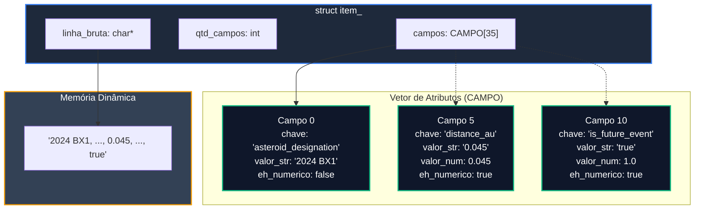
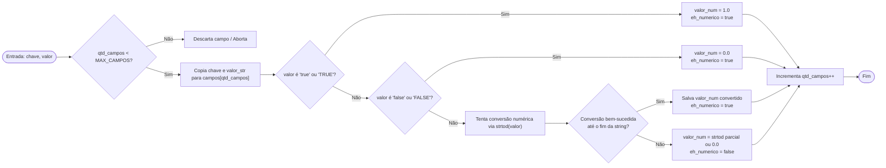

# TAD ITEM

O módulo `item` implementa o Tipo Abstrato de Dados (TAD) **Item**, responsável por encapsular, parsear, armazenar e disponibilizar os dados de um registro genérico lido dos datasets (NASA ou DETRAN).

Ele atua como o modelo de dados fundamental sobre o qual todas as estruturas de dados (`pilha`, `fila`, `lista_enc`, `lista_cabeca`, `lista_ord`, `lista_gen`, `lista_cruz`) operam de forma transparente e desacoplada.

### Visão Geral e Arquitetura

O TAD `ITEM` armazena tanto a **linha original bruta do CSV** quanto uma tabela chave-valor de campos parseados com suporte à identificação automática de tipos (numérico vs. textual).

#### Principais Características

* **Formato Dual de Parsing:** Suporta separadores de campo por vírgula `,` (dataset NASA) e por ponto e vírgula `;` com remoção de aspas (dataset DETRAN).
* **Identificação Dinâmica de Tipos:** Converte strings numéricas em valores `double` e interpreta flags booleanas (`"true"` / `"false"`) como valores numéricos `$1.0$` e `$0.0$`, respectivamente.
* **Preservação de Formato Original:** Mantém uma cópia exata de `linha_bruta` para garantir que a gravação do arquivo de saída (`--output`) ocorra sem distorções de cabeçalho, colunas ou delimitadores, com custo de formatação de  O(1).

#### Diagrama da Estrutura Interna (Mermaid)



### Definição das Estruturas Internas

```c
#define MAX_CAMPOS 35

typedef struct {
    bool eh_numerico;       /* Flag indicando se o valor é numérico ou booleano */
    char chave[50];         /* Nome da coluna/campo (ex: "distance_au", "municipio") */
    char valor_str[100];    /* Representação textual original do valor */
    double valor_num;       /* Representação numérica convertida (ou -1.0 se inválido) */
} CAMPO;

struct item_ {
    char *linha_bruta;          /* String dinâmica com a linha original do CSV */
    CAMPO campos[MAX_CAMPOS];  /* Vetor estático de atributos chave-valor */
    int qtd_campos;             /* Quantidade de campos parseados no item */
};

```

#### Eschemas de Campos Estáticos

O módulo possui esquemas predefinidos para mapear a sequência de colunas dos datasets:

1. **`CAMPOS_NASA` (20 colunas):** `asteroid_designation`, `close_approach_date`, `distance_au`, `velocity_km_s`, `risk_score`, `threat_category`, etc.
2. **`CAMPOS_DETRAN` (30 colunas):** `id`, `data_inversa`, `uf`, `municipio`, `causa_acidente`, `mortos`, `feridos`, `latitude`, `longitude`, etc.

### Especificação da API

#### Construtores e Destrutores

**`item_criar_vazio`**

Aloca e inicializa uma estrutura `ITEM` zerada via `calloc`.

```c
ITEM *item_criar_vazio(void);
```

* **Retorno:** Ponteiro para a nova estrutura `ITEM` ou `NULL` em caso de falha de alocação.
* **Complexidade:** O(1) tempo / O(1) espaço.

**`item_criar` (Parser NASA)**

Parseia uma linha CSV no formato padrão do dataset da NASA (delimitador por vírgulas `,`).

```c
ITEM *item_criar(const char linha_bruta[]);
```

* **Parâmetros:** `linha_bruta` - String contendo a linha completa lida do arquivo CSV.
* **Retorno:** Ponteiro para `ITEM` preenchido ou `NULL` em erro.
* **Complexidade:** O(M + K) tempo, onde M é o tamanho da string e K é o número de colunas do esquema da NASA (K = 20).

**`item_criar_detran` (Parser DETRAN)**

Parseia uma linha CSV no formato do dataset do DETRAN (delimitador por ponto e vírgula `;`, removendo aspas e espaços extras).

```c
ITEM *item_criar_detran(const char linha_bruta[]);
```

* **Parâmetros:** `linha_bruta` - String contendo a linha lida do CSV do DETRAN.
* **Retorno:** Ponteiro para `ITEM` preenchido ou `NULL` em erro.
* **Complexidade:** O(M + K) tempo, onde K = 30.

**`item_clonar`**

Cria uma cópia profunda (_deep copy_) do `ITEM`, duplicando tanto a estrutura interna quanto a string de `linha_bruta`.

```c
ITEM *item_clonar(const ITEM *item);
```

* **Retorno:** Novo ponteiro `ITEM*` clone ou `NULL`.
* **Complexidade:** O(M + K) tempo / O(M + K) espaço.

**`item_apagar`**

Desaloca a memória da string `linha_bruta` e da própria estrutura `ITEM`.

```c
void item_apagar(ITEM **item);
```

* **Complexidade:** O(1) tempo / O(1) espaço.

#### Acesso a Dados (Getters)

**`item_get_numero`**

Busca o valor numérico associado ao nome de um campo.

```c
double item_get_numero(const ITEM *item, const char campo[]);
```

* **Retorno:** O valor em `double` do campo consultado ou `-1.0` se o campo não existir/não for numérico.
* **Complexidade:** O(K) tempo, onde K é o número de campos armazenados (K < 35).

**`item_get_texto`**

Busca a representação textual de um determinado campo.

```c
const char* item_get_texto(const ITEM *item, const char campo[]);
```

* **Retorno:** Ponteiro constante para a string do valor ou `NULL` se não for localizado.
* **Complexidade:** O(K) tempo.

**`item_get_linha_original` e `item_print_csv`**

Retornam ou escrevem no fluxo de saída `FILE*` a linha bruta original mantendo o padrão CSV exato de entrada.

```c
const char* item_get_linha_original(const ITEM *item);
void item_print_csv(const ITEM *item, FILE *f);
```

* **Complexidade:** O(1) tempo / O(1) espaço.

#### Operações de Comparação

**`item_comparar_numero` e `item_comparar_texto`**

```c
bool item_comparar_numero(const ITEM *a, const ITEM *b, const char campo[]);
bool item_comparar_texto(const ITEM *a, const ITEM *b, const char campo[]);
```

* `item_comparar_numero`: Retorna `true` se o valor numérico do campo em `a` for estritamente maior que em `b` (`a > b`).
* `item_comparar_texto`: Retorna `true` se os valores textuais do campo forem idênticos (`strcmp == 0`).

### Fluxograma do Processamento de Campos (`item_set_campo`)



### Análise de Complexidade Assintótica

Considerando K como a quantidade total de campos de um item (K <= 35) e M como o comprimento da linha bruta em caracteres (M <= 2048):

| **Operação**                             | **Complexidade Temporal** | **Complexidade Espacial** | **Justificativa**                                                              |
| ---------------------------------------- | ------------------------- | ------------------------- | ------------------------------------------------------------------------------ |
| **`item_criar_vazio`**                   | O(1)                      | <p>O(1)<br></p>           | Alocação simples com `calloc`.                                                 |
| **`item_criar` / `item_criar_detran`**   | O(M + K)                  | O(M)                      | Parsing token por token da string e alocação de `linha_bruta`.                 |
| **`item_apagar`**                        | O(1)                      | O(1)                      | Liberação da string e da struct principal.                                     |
| **`item_get_numero` / `item_get_texto`** | <p>O(K)<br></p>           | <p>O(1)<br></p>           | Varredura linear do vetor estático `campos` de até 35 posições (O(1) prático). |
| **`item_clonar`**                        | O(M + K)                  | <p>O(M)<br></p>           | Copia o bloco de memória da struct e duplica `linha_bruta`.                    |
| **`item_print_csv`**                     | O(1)                      | O(1)                      | Impressão direta da string preservada `linha_bruta`.                           |

### Exemplo Prático de Uso

```c
#include <stdio.h>
#include "item.h"

int main(void) {
    // 1. Criar item parseando linha CSV da NASA
    const char *linha_nasa = "2024 BX1,2024 BX1,2024-01-21,2024,1,0.0003,15.2,25.4,1,false,true,0.85,3,HAZARDOUS,NONE,false,0.01,0,0,0.005";
    ITEM *ast = item_criar(linha_nasa);

    // 2. Acessar valores numéricos e textuais
    double dist = item_get_numero(ast, "distance_au");
    const char *cat = item_get_texto(ast, "threat_category");
    double is_future = item_get_numero(ast, "is_future_event");

    printf("Asteroide Categoria: %s\n", cat);
    printf("Distância AU: %.4f\n", dist);
    printf("Evento Futuro?: %s\n", is_future == 1.0 ? "SIM" : "NÃO");

    // 3. Imprimir a linha formatada no arquivo de saída
    item_print_csv(ast, stdout);

    // 4. Liberar memória
    item_apagar(&ast);

    return 0;
}
```


[Broken link](/broken/pages/fb922e107b31a3e9e9fcf81410029e993b0a9afc)

