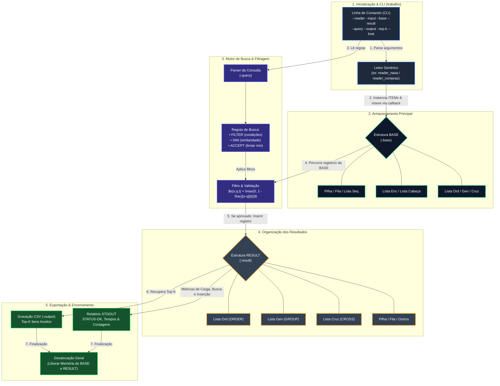
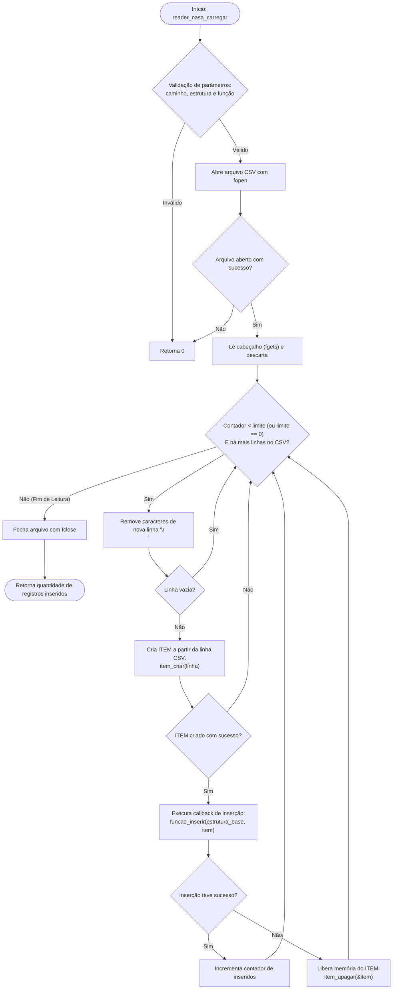

# Parte 1 - Asteroides

A **Parte 1** do projeto tem como objetivo analisar e organizar registros de aproximação de asteroides próximos à Terra.

#### Esquema dos Dados (`dados/asteroids.csv`)

Cada linha do arquivo CSV representa um **ITEM** (registro de asteroide). Os principais campos suportados e parseados incluem:

| **Campo**                          | **Tipo**   | **Descrição**                                                                 |
| ---------------------------------- | ---------- | ----------------------------------------------------------------------------- |
| `asteroid_designation`             | Texto      | Identificação do asteroide (ex: `"2024 BX1"`)                                 |
| `asteroid_fullname`                | Texto      | Nome completo do corpo celeste                                                |
| `close_approach_date`              | Texto/Data | Data estimada da aproximação                                                  |
| `year`, `month`                    | Numérico   | Ano e mês do evento                                                           |
| `distance_au`                      | Numérico   | Distância mínima em Unidades Astronômicas (AU)                                |
| `velocity_km_s`                    | Numérico   | Velocidade relativa em km/s                                                   |
| `absolute_magnitude`               | Numérico   | Magnitude absoluta (H)                                                        |
| `days_until_approach`              | Numérico   | Dias restantes/decorridos até a aproximação                                   |
| `is_past_event`, `is_future_event` | Booleano   | Indicadores temporais de evento passado/futuro                                |
| `risk_score`, `panic_level`        | Numérico   | Indicadores de risco e urgência                                               |
| `threat_category`                  | Texto      | Categoria textual (ex: `"HAZARDOUS"`, `"NON_HAZARDOUS"`)                      |
| `sentry_*`                         | Diversos   | Indicadores da lista de monitoramento Sentry (Torino, Palermo, probabilidade) |

> **Observação:** O leitor trata linhas com campos nulos ou ausentes de forma resiliente, sem interromper o processamento da base.

#### Parâmetros de Execução do Programa

Conforme especificado, o executável `trabalho` recebe o leitor `nasa` via linha de comando:

```bash
./trabalho \
  --reader nasa \
  --input dados/asteroids.csv \
  --base lista_enc \
  --result lista_ord \
  --query consultas/q1.txt \
  --output resultado.csv \
  --top-k 100 \
  --limit 10000
```

### Arquitetura

O módulo `reader_nasa` utiliza o padrão **Injeção de Dependência via Ponteiro de Função** (`funcao_inserir_fn`). Isso desacopla totalmente a leitura do arquivo CSV das estruturas de dados subjacentes (`pilha`, `fila`, `lista_enc`, `lista_cabeca`, `lista_ord`, `lista_gen`, `lista_cruz`).



#### Definição do Tipo Callback (`reader_nasa.h`)

```c
typedef bool (*funcao_inserir_fn)(void *estrutura, ITEM *item);
```

### Especificação da função principal

#### `reader_nasa_carregar`

Carrega sequencialmente os registros do arquivo CSV para a estrutura de dados especificada.

```c
int reader_nasa_carregar(
    const char *caminho_csv, 
    int limite, 
    void *estrutura_base, 
    funcao_inserir_fn funcao_inserir
);
```

* **Parâmetros:**
  * `caminho_csv`: Caminho do arquivo de entrada (ex: `"dados/asteroids.csv"`).
  * `limite`: Quantidade máxima de registros a carregar (`--limit`). Se `0`, carrega todos os registros do arquivo.
  * `estrutura_base`: Ponteiro genérico (`void *`) para a instância do TAD configurado.
  * `funcao_inserir`: Ponteiro para a função de inserção do TAD selecionado (ex: `lista_enc_inserir`, `lista_ord_inserir`).
* **Retorno:**
  * `int`: Retorna o número total de registros lidos e inseridos com sucesso na estrutura. Retorna `0` em caso de erro na abertura do arquivo ou parâmetros nulos.

### Fluxo de Processamento de Arquivo

O algoritmo realiza a leitura linha por linha mantendo uso de memória $O(1)$ adicional durante o parse:



### Análise de Complexidade Assintótica

Considerando $N$ como o número de registros lidos do arquivo CSV (limitado por `--limit`):

<table data-header-hidden><thead><tr><th></th><th width="171"></th><th width="129"></th><th></th></tr></thead><tbody><tr><td><strong>Operação</strong></td><td><strong>Complexidade Temporal</strong></td><td><strong>Complexidade Espacial</strong></td><td><strong>Justificativa</strong></td></tr><tr><td><strong>Abertura e Cabeçalho</strong></td><td><span class="math">O(1)</span><br></td><td><span class="math">O(1)</span></td><td>Leitura da primeira linha descartada.</td></tr><tr><td><strong>Parsing da Linha</strong></td><td><span class="math">O(M)</span></td><td><span class="math">O(M)</span></td><td>Onde M é o tamanho máximo de uma linha do CSV (M &#x3C;= 2048). Como M é constante, reduz a <span class="math">O(1)</span>.</td></tr><tr><td><strong>Carregamento Total</strong></td><td><span class="math">O(N \cdot T_{insercão})</span></td><td><span class="math">O(1)</span> aux.</td><td>Onde <span class="math">T_{insercão}</span> é o custo de inserção da estrutura base (<span class="math">O(1)</span> para lista simples/cabeça; <span class="math">O(N)</span> para lista ordenada).</td></tr></tbody></table>

### Exemplo de Integração no `main.c`

O código abaixo ilustra como o `reader_nasa` se conecta à estrutura genérica selecionada pelos argumentos CLI:

```c
#include <stdio.h>
#include "reader_nasa.h"
#include "lista_enc.h"

int main(int argc, char *argv[]) {
    const char *caminho_csv = "dados/asteroids.csv";
    int limit = 1000;

    // 1. Inicializa a estrutura base selecionada
    LISTA_ENC *base = lista_enc_criar();

    // 2. Executa o leitor passando a função de inserção como callback
    int carregados = reader_nasa_carregar(
        caminho_csv, 
        limit, 
        base, 
        (funcao_inserir_fn) lista_enc_inserir
    );

    printf("INPUT RECORDS=%d\n", carregados);

    // 3. Limpeza
    lista_enc_apagar(&base, true);
    return 0;
}
```

Essa implementação não utiliza o TAD pipeline nem nenhum outro TAD para consumir os dados
