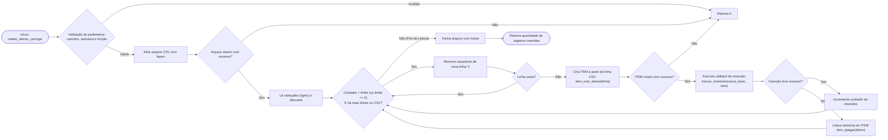

# Parte 2 - Sinistros de Trânsito

### Motivação

Escolhemos esse conjunto de dados considerando a grande quantidade de parâmetros que cada inserção possui e as inúmeras possibilidades de pesquisa e análise de dados que surgem com ele

#### Esquema dos Dados (`dados/datatran2026.csv`)

Cada linha do arquivo CSV representa um **ITEM** (registro de asteroide). Os principais campos suportados e parseados incluem:

<table data-header-hidden><thead><tr><th width="216"></th><th width="150"></th><th></th></tr></thead><tbody><tr><td><strong>Campo</strong></td><td><strong>Tipo</strong></td><td><strong>Descrição</strong></td></tr><tr><td><code>id</code></td><td>Numérico</td><td>Identificação do incidente (por exemplo: <code>804244</code>)</td></tr><tr><td><code>data_inversa</code></td><td>Texto/Data</td><td>Data da ocorrência (formato AAAA-MM-DD)</td></tr><tr><td><code>dia_semana</code></td><td>Texto</td><td>Dia da semana em que a ocorrência aconteceu (por exemplo: <code>sexta-feira)</code></td></tr><tr><td><code>horario</code> </td><td>Texto/horário</td><td>Hora da ocorrência (formato HH:mm:ss) </td></tr><tr><td><code>uf</code></td><td>Texto</td><td>Unidade federativa que registrou o incidente (por exemplo: "<code>SP</code>")</td></tr><tr><td><code>br</code></td><td>Numérico</td><td>Código da rodovia em que a ocorrência foi registrada</td></tr><tr><td><code>municipio</code></td><td>Texto</td><td>Nome do município que registrou a ocorrência em letra maiuscula</td></tr><tr><td><code>causa_acidente</code></td><td>Texto</td><td>Frase que explica a causa do acidente</td></tr><tr><td><code>tipo_acidente</code></td><td>Texto</td><td>Frase contendo a categoria do acidente (por exemplo: "colisão traseira")</td></tr><tr><td><code>classificacao_acidente</code></td><td>Texto</td><td>Classificação do acidente no que diz respeito ao estado das vítimas</td></tr><tr><td><code>fase_dia</code></td><td>Texto</td><td>Momento do dia em que o incidente ocorreu (por exemplo: "Plena Noite")</td></tr><tr><td><code>sentido_via</code></td><td>Texto</td><td>Sentido da via em que o acidente ocorreu (por exemplo: "Crescente")</td></tr><tr><td><code>condicao_metereologica</code></td><td>Texto</td><td>Condição metereológica no momento do acidente (por exemplo: "Céu Claro")</td></tr><tr><td><code>tipo_pista</code></td><td>Texto</td><td>Tipo da pista, no que diz respeito ao número de vias (por exemplo: "Simples")</td></tr><tr><td><code>trancado_via</code></td><td>Texto</td><td>Formato da via no local do acidente (por exemplo: "Curva")</td></tr><tr><td><code>uso_solo</code></td><td>Texto</td><td>Indica se o acidente fez com que algum veículo saísse da pista</td></tr><tr><td><code>pessoas</code></td><td>Numérico</td><td>Número de pessoas envolvidas no incidente</td></tr><tr><td><code>mortos</code></td><td>Numérico</td><td>Número de vitimas fatais do acidente</td></tr><tr><td><code>feridos_leves</code></td><td>Numérico</td><td>Número de feridos leves envolvidos no acidente</td></tr><tr><td><code>feridos_graves</code></td><td>Numérico</td><td>Número de feridos graves envolvidos no acidente</td></tr><tr><td><code>ilesos</code></td><td>Numérico</td><td>Número de envolvidos no acidente que não se feriram</td></tr><tr><td><code>ignorados</code></td><td>Numérico</td><td>Número de pessoas presentes no momento do acidente mas que não foram considerados envolvidos</td></tr><tr><td><code>feridos</code></td><td>Numérico</td><td>Total de feridos (soma dos feridos leves com os feridos graves)</td></tr><tr><td><code>latitude</code></td><td>Texto</td><td>Latitude do local da ocorrência</td></tr><tr><td><code>longitude</code></td><td>Texto</td><td>Longitude do local da ocorrência</td></tr><tr><td><code>regional</code></td><td>Texto</td><td>Código regional da ocorrência</td></tr><tr><td><code>delegacia</code></td><td>Texto</td><td>Código da delegacia que assumiu a ocorrência</td></tr><tr><td><code>uop</code></td><td>Texto</td><td>Código completo da ocorrência que contem o regional, a delegacia e a UF da ocorrência</td></tr></tbody></table>

> **Observação:** O leitor trata linhas com campos nulos ou ausentes de forma resiliente, sem interromper o processamento da base.

#### Parâmetros de Execução do Programa

Conforme especificado, o executável `trabalho` recebe o leitor `detran` via linha de comando:

```bash
./trabalho \
  --reader detran \
  --input dados/datatran2026.csv \
  --base lista_enc \
  --result lista_ord \
  --query consultas/q2.txt \
  --output resultado.csv \
  --top-k 100 \
  --limit 10000
```

### Arquitetura&#x20;

Assim como o leitor da NASA, o `reader_detran` utiliza o padrão **Injeção de Dependência via Ponteiro de Função** (`funcao_inserir_fn`). Isso garante que a leitura do arquivo CSV e o parsing dos dados fiquem 100% isolados das estruturas de dados subjacentes (`pilha`, `fila`, `lista_enc`, `lista_cabeca`, `lista_ord`, `lista_gen`, `lista_cruz`).

#### Definição do Tipo Callback (`reader_detran.h`)

```c
typedef bool (*funcao_inserir_fn)(void *estrutura, ITEM *item);
```

### Especificação da função principal&#x20;

### `reader_detran_carregar`

Lê e processa o arquivo CSV do DETRAN, inserindo os itens na estrutura de dados recebida.

```c
int reader_detran_carregar(
    const char *caminho_csv, 
    int limite, 
    void *estrutura_base, 
    funcao_inserir_fn funcao_inserir
);
```

* **Parâmetros:**
  * `caminho_csv`: Caminho do arquivo contendo o dataset (ex: `"dados/acidentes_detran.csv"`).
  * `limite`: Quantidade máxima de registros a carregar (`--limit`). O valor `0` indica a leitura do arquivo completo.
  * `estrutura_base`: Ponteiro genérico (`void *`) para a instância da estrutura de dados base.
  * `funcao_inserir`: Ponteiro para a função de inserção pertencente à estrutura utilizada (ex: `lista_enc_inserir`, `lista_cruz_inserir`).
* **Retorno:**
  * `int`: Retorna a quantidade total de registros parseados e inseridos com sucesso na estrutura base. Retorna `0` em caso de erro na abertura do arquivo ou se qualquer parâmetro obrigatório for `NULL`.

### Fluxo de Processamento de Arquivo

O algoritmo realiza a leitura linha por linha mantendo o consumo de memória adicional $O(1)$ durante a fase de parsing:



### Análise de Complexidade Assintótica

Considerando $N$ como a quantidade de registros parseados do arquivo (delimitada pelo parâmetro `--limit`):

<table data-header-hidden><thead><tr><th width="204"></th><th width="159"></th><th width="151"></th><th></th></tr></thead><tbody><tr><td><strong>Operação</strong></td><td><strong>Complexidade Temporal</strong></td><td><strong>Complexidade Espacial</strong></td><td><strong>Justificativa</strong></td></tr><tr><td><strong>Abertura e Cabeçalho</strong></td><td><span class="math">O(1)</span><br></td><td><span class="math">O(1)</span></td><td>Abertura do arquivo e descarte da linha de títulos.</td></tr><tr><td><strong>Parsing da Linha (<code>item_criar_detran</code>)</strong></td><td><span class="math">O(M)</span></td><td><span class="math">O(M)</span></td><td>M é o comprimento da linha do CSV (M &#x3C;= 2048). Por ser limitado, equivale a <span class="math">O(1)</span>.</td></tr><tr><td><strong>Carregamento Total</strong></td><td><br><span class="math">O(N \cdot T_{\text{inserção}})</span></td><td><span class="math">O(1)</span> aux.</td><td>Onde <span class="math">T_{insercão}</span> é o custo de inserção no TAD base (<span class="math">O(1)</span> para pilhas/listas simples, <span class="math">O(N)</span> para lista ordenada).</td></tr></tbody></table>

### Exemplo de Integração no `main.c`

O snippet abaixo exemplifica como a CLI delega o carregamento para o `reader_detran` dinamicamente:

```c
#include <stdio.h>
#include <string.h>
#include "reader_detran.h"
#include "lista_enc.h"
#include "cli.h"

int main(int argc, char *argv[]) {
    CONFIG *cli = cli_criar();
    cli_parse_args(cli, argc, argv);

    // Verifica se o leitor selecionado foi o DETRAN
    if (strcmp(cli_get_reader(cli), "detran") == 0) {
        LISTA_ENC *base = lista_enc_criar();

        int carregados = reader_detran_carregar(
            cli_get_input(cli),
            cli_get_limit(cli),
            base,
            (funcao_inserir_fn) lista_enc_inserir
        );

        printf("STATUS-OK\n");
        printf("INPUT RECORDS=%d\n", carregados);

        // ... execução das consultas ...

        lista_enc_apagar(&base, true);
    }

    cli_apagar(&cli);
    return 0;
}

```
