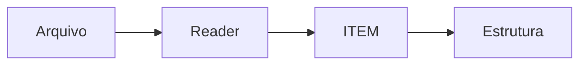

# Gerenciador de registros

Projeto desenvolvido para a disciplina SCC0202 - Algoritmos e Estruturas de Dados I no ano de 2026 por Pedro Iori Garcia e Gabriel Galli Brandini

***

&#x20;Conheça as estruturas disponíveis abaixo:



## Pilha ($$pilha$$)

Estrutura linear de acesso LIFO (_Last-In, First-Out_), na qual a inserção e a remoção de registros ocorrem exclusivamente na extremidade superior. No projeto, funciona como uma das opções de Tipo Abstrato de Dados (TAD) para armazenar todo o dataset lido ou os resultados obtidos após a execução de uma consulta.





## Fila ($$fila$$)

Estrutura de dados linear regida pelo princípio FIFO (_First-In, First-Out_), em que os novos registros são inseridos ao final e as remoções ocorrem no início. Permite guardar a base completa ou organizar os resultados correspondentes mantendo rigorosamente a ordem em que foram processados.



## Lista sequencial ($$fila \_ seq$$)

Estrutura de dados baseada em alocação contígua de memória, onde os itens são dispostos em posições sequenciais indexadas. É utilizada tanto para a carga completa do arquivo de entrada quanto para conter o conjunto de dados filtrado pelo programa.



## Lista encadeada ($$lista\_enc$$)

Estrutura composta por nós alocados dinamicamente na memória, onde cada elemento se conecta ao próximo por meio de ponteiros. Oferece flexibilidade no gerenciamento de memória para armazenar a base principal de dados ou os itens retornados pela busca.



## Lista com Cabeça ($$lista\_cabeca$$**)**

Estrutura encadeada que inclui obrigatoriamente um nó cabeça ou sentinela no início, o qual serve de referência fixa e não armazena dados. Todas as operações de inserção, remoção, busca e percurso utilizam essa representação para padronizar e simplificar a manipulação da lista.



## Lista ordenada ($$lista\_ord$$)

Estrutura na qual a ordenação dos registros é mantida de forma contínua no exato momento de cada inserção, utilizando como chave um critério especificado na consulta. A implementação proíbe o armazenamento prévio dos dados sem ordem para posterior ordenação final.



## Lista generalizada ($$lista\_gen$$)

Estrutura avançada que organiza os registros em grupos e subgrupos hierárquicos a partir dos campos configurados no comando de agrupamento (como organizar por categoria de ameaça e, em seguida, por ano). Permite estruturar e navegar pelo dataset através de múltiplos níveis de subconjuntos.



## Lista cruzada ($$lista\_cruz$$)

Estrutura avançada multidimensional que permite que um mesmo registro participe de duas organizações de navegação simultâneas sem a necessidade de duplicar o dado na memória. Habilita o percurso dos itens sob dois eixos de análise distintos, como a travessia por categoria de ameaça ou por ano.



* Cada estrutura de dados trabalha de forma independente das demais e é de responsabilidade do usuário escolher qual estrutura armazenará o seu dataset.
* A escolha da estrutura altera efetivamente a organização dos itens
* Cada estrutura de dados possui funções auxiliares que permitem interagir com os dados contidos nelas&#x20;

## Como funciona?



#### Reader

O reader escolhido recebe o caminho do arquivo contendo o dataset, a estrutura escolhida e a função de inserção correspondente à ela.&#x20;

Ele transforma cada linha do arquivo em uma estrutura do tipo ITEM e insere na estrutura escolhida utilizando a função passada

Veja mais sobre o arquivo Reader:



#### TAD ITEM

Cada linha lida pelo reader é enviada como string para a função item\_criar, que separa os valores de cada campo em parâmetros de uma estrutura especial do tipo ITEM

Para o dataset incial, responsável pela parte 1 do trabalho, a struct ITEM possui o seguinte formato:


```c
struct item_{
    bool alterado; 
    char *linha_bruta;
    char asteroid_designation[25];
    char asteroid_fullname[35];
    int year;
    int month;
    double distance_au;
    double velocity_km_s;
    double absolute_magnitude; 
    int days_until_approach;
    bool is_past_event;
    bool is_future_event;
    double risk_score;  
    int panic_level;
    char threat_category[20];
    char panic_verdict[50];
    bool on_sentry_list;
    char sentry_impact_prob; 
    double sentry_torino_scale;
    double sentry_palermo_scale;
    double sentry_diameter_km;
};
```


Veja mais sobre o TAD ITEM:





#### Retorno

Após inserir cada item na estrutura, o reader retorna um inteiro que corresponde ao número de inserções realizadas






