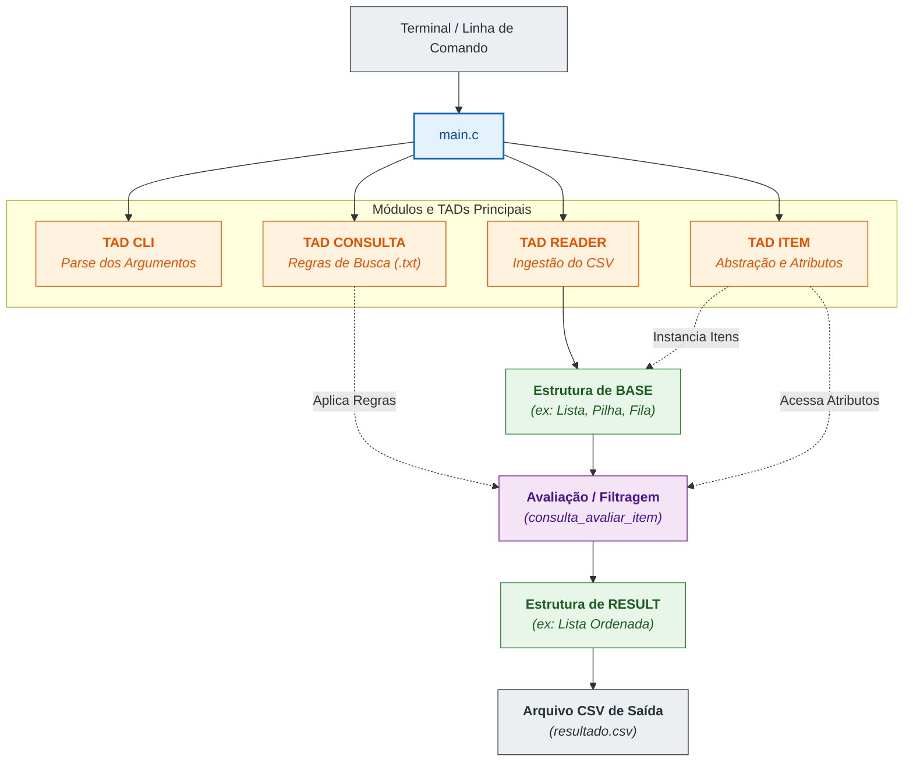

# Projeto 1 - Algoritmos e Estruturas de Dados I

Projeto desenvolvido para a disciplina SCC0202 - Algoritmos e Estruturas de Dados I no ano de 2026 por Pedro Iori Garcia e Gabriel Galli Brandini

***

### Objetivo da documentação:

Essa documentação foi desenvolvida com o objetivo de complementar a entrega do trabalho e de auxiliar na compreensão dos processos que levaram ao desenvolvimento do código, além do funcionamento do projeto em si.

## Conheça o projeto:

Veja as estruturas de dados disponíveis abaixo:



## Pilha ($$pilha$$)

Estrutura linear de acesso LIFO (_Last-In, First-Out_), na qual a inserção e a remoção de registros ocorrem exclusivamente na extremidade superior. No projeto, funciona como uma das opções de Tipo Abstrato de Dados (TAD) para armazenar todo o dataset lido ou os resultados obtidos após a execução de uma consulta.





## Fila ($$fila$$)

Estrutura de dados linear regida pelo princípio FIFO (_First-In, First-Out_), em que os novos registros são inseridos ao final e as remoções ocorrem no início. Permite guardar a base completa ou organizar os resultados correspondentes mantendo rigorosamente a ordem em que foram processados.



## Lista sequencial ($$fila \_ seq$$)

Estrutura de dados baseada em alocação contígua de memória, onde os itens são dispostos em posições sequenciais indexadas. É utilizada tanto para a carga completa do arquivo de entrada quanto para conter o conjunto de dados filtrado pelo programa.



## Lista encadeada ($$lista\_enc$$)

Estrutura composta por nós alocados dinamicamente na memória, onde cada elemento se conecta ao próximo por meio de ponteiros. Oferece flexibilidade no gerenciamento de memória para armazenar a base principal de dados ou os itens retornados pela busca.



## Lista com Cabeça ($$lista\_cabeca$$**)**

Estrutura encadeada que inclui obrigatoriamente um nó cabeça ou sentinela no início, o qual serve de referência fixa e não armazena dados. Todas as operações de inserção, remoção, busca e percurso utilizam essa representação para padronizar e simplificar a manipulação da lista.



## Lista ordenada ($$lista\_ord$$)

Estrutura na qual a ordenação dos registros é mantida de forma contínua no exato momento de cada inserção, utilizando como chave um critério especificado na consulta. A implementação proíbe o armazenamento prévio dos dados sem ordem para posterior ordenação final.



## Lista generalizada ($$lista\_gen$$)

Estrutura avançada que organiza os registros em grupos e subgrupos hierárquicos a partir dos campos configurados no comando de agrupamento (como organizar por categoria de ameaça e, em seguida, por ano). Permite estruturar e navegar pelo dataset através de múltiplos níveis de subconjuntos.



## Lista cruzada ($$lista\_cruz$$)

Estrutura avançada multidimensional que permite que um mesmo registro participe de duas organizações de navegação simultâneas sem a necessidade de duplicar o dado na memória. Habilita o percurso dos itens sob dois eixos de análise distintos, como a travessia por categoria de ameaça ou por ano.



* Cada estrutura de dados trabalha de forma independente das demais e é de responsabilidade do usuário escolher qual estrutura armazenará o seu dataset.
* A escolha da estrutura altera efetivamente a organização dos itens
* Cada estrutura de dados possui funções auxiliares que permitem interagir com os dados contidos nelas&#x20;

## Como funciona?



#### Reader e CLI

O cliente envia os argumentos e configurações escolhidas na linha de execução do programa, que é parseada pelo módulo CLI, a partir dele, o módulo reader escolhido recebe o caminho do arquivo contendo o dataset, a estrutura escolhida e a função de inserção correspondente à ela.

Ele transforma cada linha do arquivo em uma estrutura do tipo `ITEM` e insere na estrutura escolhida utilizando a função passada



#### TAD `ITEM`

Cada linha lida pelo reader é enviada como string para a função `item_criar`, que separa os valores de cada campo em parâmetros de uma estrutura especial do tipo `ITEM`

Para o dataset inicial, responsável pela parte 1 do trabalho, a struct `ITEM` possui o seguinte formato:


```c
struct item_{
    bool alterado; 
    char *linha_bruta;
    char asteroid_designation[25];
    char asteroid_fullname[35];
    int year;
    int month;
    double distance_au;
    double velocity_km_s;
    double absolute_magnitude; 
    int days_until_approach;
    bool is_past_event;
    bool is_future_event;
    double risk_score;  
    int panic_level;
    char threat_category[20];
    char panic_verdict[50];
    bool on_sentry_list;
    char sentry_impact_prob; 
    double sentry_torino_scale;
    double sentry_palermo_scale;
    double sentry_diameter_km;
};
```




### Estrutura base

Cada item é inserido na estrutura escolhida para servir como base. Eles podem ser armazenados diretamente em um array de tipo `ITEM` ou em estruturas `struct no_` a depender da escolha da estrutura.



### TAD `CONSULTA`

Juntamente com as configurações iniciais, a CLI recebe um arquivo `.txt` que contém um série de regras de filtragem e estilização que ditarão como o arquivo de saída será gerado.



### Avaliação e filtragem (`consulta_avaliar_item`)

A estrutura de dados base passa, então, pela função `consulta_avaliar_item` dentro do próprio arquivo do TAD `CONSULTA` . Essa função é responsável por selecionar e inserir os itens aptos dentro da estrutura de dados de retorno que foi previamente escolhida pelo usuário



#### Estrutura de result

A estrutura resultante é, por fim, inserida dentro de um novo arquivo .csv&#x20;





A Parte 1 do projeto consiste no desenvolvimento de uma _engine_ de processamento, filtragem e cálculo de similaridade de dados astronômicos em linguagem C. O sistema foi projetado sob uma arquitetura fortemente modular e orientada a Tipos Abstratos de Dados (TADs), permitindo manipular grandes volumes de dados de asteroides (dataset _Near-Earth Objects_ da NASA) de forma eficiente e sem vazamentos de memória.

### Arquivo de consulta e motor de regras

O TAD `CONSULTA` feito para a parte 1 do projeto é capaz de interpretar 6 comandos de configuração no arquivo de entrada:

| Comando  | Sintaxe exemplo                    | Descrição                                                                                          |
| -------- | ---------------------------------- | -------------------------------------------------------------------------------------------------- |
| `FILTER` | `FILTER distance_au\|<=10.08`      | Filtro booleano rígido (`==`, `!=`, `<`, `>`, `<=`, `>=`). Itens fora do critério são descartados. |
| `SIM`    | `SIM velocity_km_s\|15.0 10.0 1.0` | Define métrica de similaridade ponderada: `campo\|alvo tolerancia peso`.                           |
| `ACCEPT` | `ACCEPT 0.60`                      | Nota/limiar mínimo de similaridade para aceitação do item (entre `0.0` e `1.0`).                   |
| `ORDER`  | `ORDER similarity\|DESC`           | Define o campo de ordenação dos resultados e a direção (`ASC` ou `DESC`).                          |
| `GROUP`  | `GROUP threat_category\|year`      | Parâmetros de agrupamento multinível para estruturas avançadas.                                    |
| `CROSS`  | `CROSS threat_category year`       | Parâmetros para visualizações cruzadas/matriOrder.                                                 |

#### Cálculo da Similaridade Ponderada

Quando regras `SIM` são especificadas, a pontuação ($$S$$) de um item é calculada pela média ponderada das similaridades locais:

<p align="center"><span class="math">s_{local} = \max\left(0, 1 - \frac{\vert{}valor_{item} - alvo\vert{}}{tolerancia}\right)</span></p>

<p align="center"><span class="math">S_{total} = \frac{\sum (s_{local} \times peso)}{\sum peso}</span></p>

### Destaques da Engenharia do Projeto

* Zero Memory Leak: Gerenciamento rigoroso de memória dinâmica em C (`malloc`, `calloc`, `realloc`, `free`), testado e validado via Valgrind.
* Ponteiros Opaque e Encapsulamento: Estruturas internas ocultas nos arquivos `.c`, expondo apenas ponteiros opacos nos cabeçalhos (`.h`).
* Desacoplamento via Callbacks: O leitor de dados e as estruturas de dados não possuem dependência direta entre si, comunicando-se via `void*` e ponteiros de função.
* Resiliência de Parser: Tratamento defensivo de strings para lidar com variações de quebra de linha de diferentes sistemas operacionais (`\r\n` vs `\n`).

### Exemplo de execução:

Compilação do projeto com flags estritas:

```bash
gcc -Wall -Wextra -pedantic -Iinclude src/*.c -o trabalho -lm
```

Execução do pipeline completo:

```bash
./trabalho --reader nasa \
          --input dados/asteroids.csv \
          --base lista_enc \
          --result lista_ord \
          --query consultas/q1.txt \
          --output resultado.csv \
          --top-k 100 \
          --limit 10000
```

Todos os arquivos do projeto estão devidamente documentados na [Documentação](https://app.gitbook.com/o/PsT8znIAyEpCRNzCjU0B/s/iunjpYXuo9JOS4Sy0saW/ "mention")
